# Neutron 2 — F′ on the Artemis CubeSat Kit

**BLUF:** This repository develops the Neutron 2 UNP FlatSat demo on Artemis prototype hardware. The **October 2026 CDR target** is OBC integration with the real payload and PDU: turn payload power on, collect and return raw data, then turn payload power off. CDR connects Pi Zero W F′ directly to Pi 5 Yamcs using stock ComCcsds over TCP and stock FileDownlink; it does not use a network mux or SatNOGS/SDR/RF. The physical Pi↔Teensy UART mux channel 2 remains for PDU RPC. The **December 2026 FSR target** adds the full Yamcs/SDR/SatNOGS chain around payload + PDU, with the previously planned scheduling and nominal modes. Final local native CDR and legacy Yamcs regressions pass; Pi deployment and real payload/PDU acceptance remain open. See the [portable CDR evidence pack](docs/verification/evidence/n2-cdr-tcp-2026-10-20/README.md).

Updated October 20, 2026; incorporates the CDR TCP selection. Dennis confirmed USB↔RS-422 payload command/telemetry, the Pi Zero W/Teensy split, Pi 5 Ubuntu/Yamcs ground hosting, and Sam/Zach SatNOGS firmware/SPI and SDR ownership. Work in `neutron2-develop`; preserve the frozen July `neutron_2` / `v1.0.0-mvp-demo` baseline for comparison. Check the actual branch and local changes before editing.

## UNP demo targets

| | October CDR | December FSR |
| --- | --- | --- |
| Systems | OBC + payload + PDU | OBC + payload + PDU + complete COMMS/ground chain |
| Operator | Pi Zero W F′ TCP ↔ LAN ↔ Pi 5/Yamcs; browser operators on LAN | Yamcs on Pi 5 Ubuntu, accessed over the LAN |
| Command/data path | Direct CCSDS over LAN TCP; stock FileDownlink; physical UART mux channel 2 for PDU RPC; no SatNOGS/SDR/RF | Yamcs ↔ SDR ↔ SatNOGS ↔ OBC ↔ payload |
| Payload power | PDU turns payload on/off; confirm readiness and retrieve data before power-off | Retain PDU power control within the complete mission sequence |
| Collection | Command collection and inspect retained raw data | Previously planned scheduled collection and nominal modes, with end-to-end raw-data return |
| Acceptance | Real payload acquisition, PDU power-on/off, and independently verified stock FileDownlink receipt | Full payload/PDU/COMMS sequence and independently verified ground receipt |

**Transport selected October 20:** use the stock F′ TCP server on the Zero W and the Pi 5 Yamcs tcp-fast-client, with direct ComCcsds and stock FileDownlink. Do not add a network mux or move the accepted custom channel-1 workflow into CDR. Final native local checks passed both supplied files with independent Yamcs GET byte/hash checks, disconnect recovery, fake channel-2 PDU RPC, legacy Yamcs regressions, guard tests, and startup cancellation. This is not hardware acceptance. See [development intent](docs/planning/DEVELOPMENT_INTENT.md), the [CDR TCP/Yamcs implementation plan](docs/planning/CDR_TCP_YAMCS_IMPLEMENTATION_PLAN.md), [CDR TCP runbook](docs/operations/CDR_TCP.md), and [portable evidence pack](docs/verification/evidence/n2-cdr-tcp-2026-10-20/README.md). ADCS, geo-based commanding and D2S2 HIL remain below the core demo priorities.

## Target hardware and data flow

CDR uses the stock F′ TCP server on the Pi Zero W and the Yamcs tcp-fast-client on Pi 5. ComCcsds carries command, telemetry, and stock FileDownlink directly over TCP; there is no network mux. The Pi 5 ground bridge composes stock TCP/UDP adapters, the TM frame aggregator, and PacketBridge with a small 5 ms TM pacing wrapper. The independent physical UART mux channel 2 remains connected to the satellite Teensy for PDU v2 RPC. Final local native loopback, file checks and legacy regression passed; Pi deployment and hardware acceptance remain open. The diagram below is the **full FSR target**; its SatNOGS/SDR/RF path is deferred from CDR.

```mermaid
flowchart LR
    Browser["Operator browser"] <-->|"LAN"| Ground["Pi 5 Ubuntu / Yamcs"]
    Ground <-->|"USB / team-owned SDR software"| SDR["USRP B200"]
    SDR <-->|"UHF conducted RF / SMA-coax"| Radio["Separately powered SatNOGS-COMMS v0.3.2 PHASMA PC104"]
    Radio <-->|"SPI breakout / 6-pin Molex-to-PC104 harness; pinout TBD"| OBC["Pi Zero W / F′ custom SatNOGS driver"]
    OBC <-->|"USB ↔ RS-422; raw-file contract open"| PLD["Real Neutron 2 payload"]
    OBC <-->|"UART mux channel 2 / local RPC"| Teensy["Satellite Teensy"]
    Teensy <-->|"UART / PDU protocol v2"| PDU["Artemis PDU hardware v2.2"]
    PDU -->|"Payload power on/off"| PLD
```



This is the intended integration path, not an accepted wiring diagram. The satellite Pi Zero W runs the spacecraft F′ binary with the Teensy as its embedded partner; the Pi 5 runs Yamcs/F′ ground services and serves browsers over the router LAN. The [ground-host plan](docs/integration/GROUND_HOST.md) still needs deployment/resource validation. USB↔RS-422 is selected for payload command/telemetry; adapter/settings and payload file boundary remain to be agreed. CDR uses stock ComCcsds and FileDownlink over TCP; the earlier custom channel-1 science flow remains a separate local software acceptance. SatNOGS is FSR scope. Sam and Zach handle SatNOGS firmware/SPI and SDR; the Pi Zero W SPI controller is selected; exact firmware, harness pinout, MCU packet endpoint and SDR software handoff remain open.

F′ owns command handling, mission coordination, raw-product retention, and downlink policy. Applications use managers and drivers so hardware protocols stay below mission logic. The payload team's JAR owns actual science interpretation; FSW handles opaque raw files. Synthetic plots are software regression fixtures, not calibrated detector science. See [system architecture](docs/architecture/SYSTEM_ARCHITECTURE.md).

## What works now

The accepted macOS arm64 software profile runs **Yamcs + host-native F′ + simulated payload + software UART links** on one computer:

- Literal synthetic pass-through, serialized payload admission, correlated outcomes, timeout/failure recovery, and stale/duplicate response rejection.
- Raw capture → immutable storage → custom channel-1 delivery → independent reconstruction → Yamcs object readback and integrity verification in the accepted local software profile.
- Token-correlated VERIFIED command stages; sender completion alone cannot declare ground delivery.
- Restart recovery, product selection, persistent identities, and a 16-product catalog. Delivery retains the onboard product; ACK-based reclamation is deferred.
- Simulated count-CSV and pulse-science displays, including waveform, integrated-charge spectrum, and PSD density views.

[Software baseline](docs/verification/SOFTWARE_BASELINE.md) records October 8–14 acceptance and its limits. The October 18 setup rerun at source `5429a2f` passed the native local-Yamcs build, six C++ component suites, 26 Python tests, transport checks, Yamcs PING/Pong, exact synthetic pass-through, and two pulse captures with independent raw readback plus invalid-duration/failure checks. This rerun did not replay every historical lifecycle or restart scenario. Local evidence is under ignored `yamcs/run/20261018-145218/` on the setup host; it is not a portable checked-in acceptance package.

**Still open:** Pi Zero W ARMv6 build/runtime and Pi 5 LAN deployment; real payload command/data contract; and real PDU power, readiness, acquisition, and off-state acceptance. The FSR COMMS/mode/scheduling sequence also remains open. See [hardware integration](docs/integration/README.md). Prior July RFM23BP HIL evidence does not close these gates.

## Local setup and demo

Use Python 3.11 and a native C++ toolchain. F′ is pinned to v4.2.1 (`a750219`); the PDU reference is pinned to `f287924`. Follow [one-time setup](docs/operations/LOCAL_SETUP.md) for checkout/submodule preparation. From this repository root:

```sh
./tools/yamcs/bootstrap.sh
./tools/yamcs/build_native.sh
./tools/yamcs/run_pulses.sh
```

Open [Yamcs](http://127.0.0.1:8090), select `fprime-project` / `realtime`, and open the [science viewer](http://127.0.0.1:8063). Follow the [daily quickstart](docs/operations/QUICKSTART.md) to issue `scienceApp.VERIFIED_COLLECT_AND_DOWNLINK` with a new nonzero token and confirm all completion stages. Stop with Ctrl+C or `./tools/yamcs/stop.sh`.

No daily rebuild is needed unless software/configuration changed. The launcher binds loopback on the same computer; it does not provide the planned LAN ground station. macOS arm64 is verified. Windows F′ development uses WSL; the complete local Yamcs stack remains unvalidated there.

`build_native.sh` explicitly selects `NEUTRON2_LOCAL_YAMCS=ON`. A generic native generate can select the OFF/RF profile. Neither the host executable nor its test link capacities are a hardware release. On the October 18 host, `pip check` flags the pinned CMake 3.26.0 wheel's platform metadata although CMake and native/UT builds run successfully; retain this tooling caveat when reproducing setup.

## Developer checks

From `ArtemisRpiTeensy_N2`, with its F′ environment activated:

```sh
. fprime-venv/bin/activate
fprime-util generate --ut -f
fprime-util build --ut
fprime-util check --all
```

After UTs, restore the local-Yamcs artifact with `./tools/yamcs/build_native.sh` from the repository root before replaying the demo. See [build/test](docs/development/BUILD_AND_TEST.md) and the [Yamcs runbook](docs/development/YAMCS_LOCAL_TESTING.md) for serialized functional probes. `tools/validate_local.sh` exercises the older GDS comparison workflow; it is not the current UNP hardware acceptance gate.

## Repository map

| Path | Purpose |
| --- | --- |
| `ArtemisRpiTeensy_N2/` | Active F′ components, ports, topology, and pinned framework |
| `tools/yamcs/`, `yamcs/config/` | Local stack, receiver/verifier, synthetic viewer, and regression probes |
| `external/payload-neutron-simulation/` | Count-CSV simulator; pulse fixture is under `tools/yamcs/pulse_sim/` |
| `external/artemis-pdu/` | PDU firmware/ICD and bench-tool reference |
| `ArtemisTeensy_N2_Baremetal/`, `GDS_Teensy/` | Earlier satellite/ground Teensy RFM23BP firmware; retained comparison baseline |
| `config/transport_constants.json` | Generated UART/legacy RF contract inputs; not a SatNOGS ICD |
| `ground-station/`, `student_onboarding/` | Earlier payload viewer and student exercises; use current mission-ops docs first |
| `docs/` | Operations, architecture, integration, verification, and planning |

## Read next and hardware questions

- [CDR TCP/Yamcs implementation plan](docs/planning/CDR_TCP_YAMCS_IMPLEMENTATION_PLAN.md): current local status and acceptance; [runbook](docs/operations/CDR_TCP.md) for the local profile.

- [System architecture](docs/architecture/SYSTEM_ARCHITECTURE.md): ownership, CDR payload/PDU and FSR full-chain sequences, and evidence gates.
- [PDU integration](docs/integration/PDU.md): CDR payload on/collect/retain/off sequence, rail/readback, startup/shutdown and operator-path questions.
- [Payload contract](docs/integration/PAYLOAD.md): USB↔RS-422 adapter/settings, command/duration units, readiness, raw-file boundary, integrity, and recovery. Aris owns PLD; Dennis owns the F′ integration.
- [SatNOGS/SDR contract](docs/integration/SATNOGS.md): board/firmware, SPI endpoint and controller, framing, backpressure, and ground handoff. Dennis owns the F′ driver; Sam/Zach own SatNOGS firmware/SPI and SDR. The SDR is a USRP B200; agree the software handoff.
- [Ground host](docs/integration/GROUND_HOST.md): confirm purchased Pi/SDR, Ubuntu version, network, and representative load.
- [Full documentation index](docs/README.md) and [SDD gap plan](docs/planning/SDD_GAP_PLAN.md).
- [Historical GDS/RFM23BP demo](docs/archive/legacy-gds-rfm23bp/README.md): July release, bench runbooks, and previous architecture. Use revision-matched instructions for that baseline.

Keep local software results, target build/runtime, hardware/RF/HIL acceptance, and flight qualification as separate evidence.
