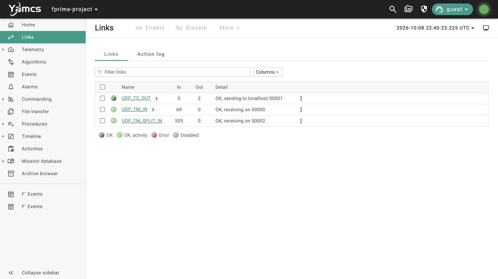
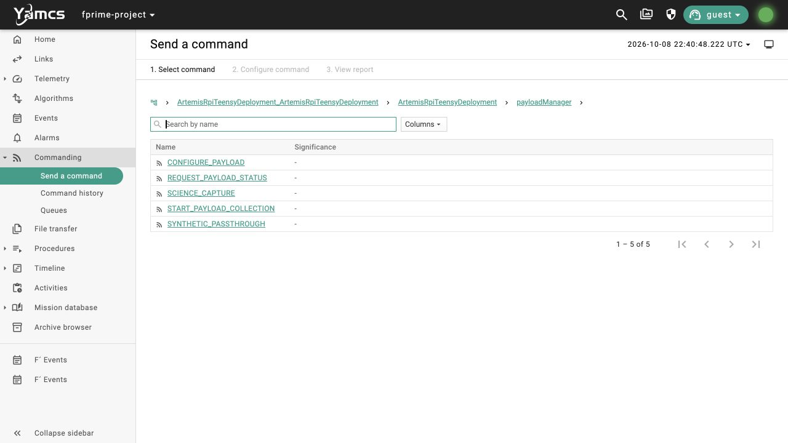
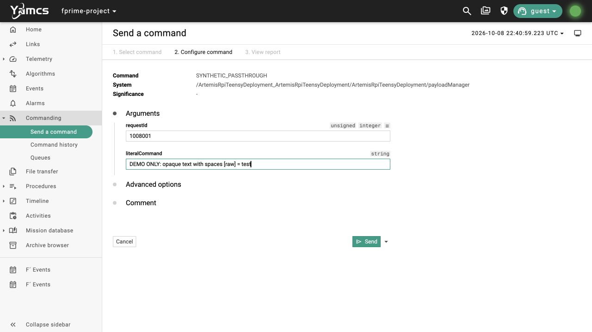
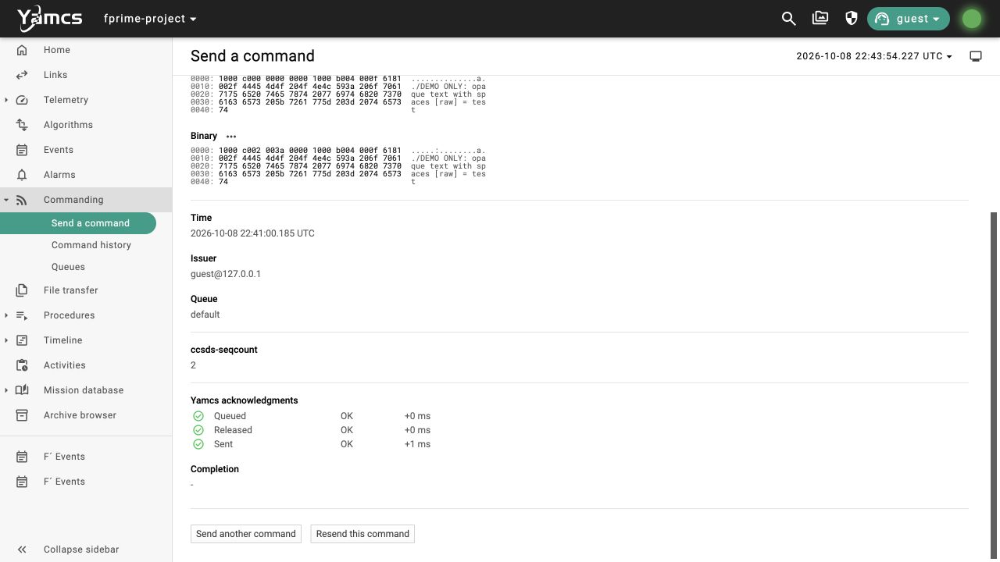
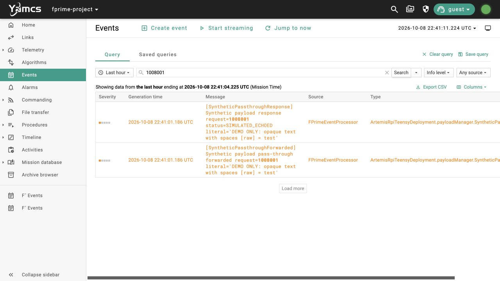

# N2 Yamcs pass-through operator walkthrough — October 8, 2026

**BLUF:** This working software demo sends a literal command from Yamcs through F′ to a simulated payload driver, then shows its unchanged echo and request ID in Yamcs. It needs no mode transition. It does not collect science or operate hardware; raw-file return and the ground histogram are later work.

The demo passed before these screenshots were taken. The automated Yamcs check verified 59-byte and 128-byte ASCII literals, matching request IDs, `SIMULATED_ECHOED`, and unchanged `BASE` mode. The illustrated UI replay also passed an independent read-only Yamcs check.

## Start the software stack

Use the local native profile on your development computer. The intended hardware OBC is the Pi Zero W, but this walkthrough uses the host simulator.

From the repository root on macOS:

```sh
cd /path/to/neutron_2
# First setup only:
./tools/yamcs/bootstrap.sh
# Build after pulling/changing F′ source or its dictionary:
./tools/yamcs/build_native.sh
# Leave this running in its terminal:
./tools/yamcs/run.sh
```

If this checkout's stack is already running, use it instead of starting a second copy. Open [Yamcs](http://127.0.0.1:8090/), select `fprime-project`, and use processor `realtime`. The launcher checks the local profile's framing/string constants before starting. It records the binary/dictionary hashes and source state for the run.

Windows developers use WSL for the native F′ build and these shell commands, then open the Yamcs URL in a browser. This change was exercised on macOS arm64; WSL has not been exercised. See the [local setup runbook](N2_YAMCS_LOCAL_TESTING_2026-10-07.md) for dependencies and transport details.

## 1. Check Links

Select **Links**. `UDP_TC_OUT`, `UDP_TM_IN`, and `UDP_TM_SPLIT_IN` should be enabled and report `OK`. The telemetry input counts should increase while the stack runs. These are the software bridge links used by this demo.



## 2. Select the command

Expand **Commanding → Send a command**, then open these folders:

`ArtemisRpiTeensyDeployment_ArtemisRpiTeensyDeployment → ArtemisRpiTeensyDeployment → payloadManager`

Select **SYNTHETIC_PASSTHROUGH**.



## 3. Enter a new request ID and dummy literal

For the illustrated example:

| Argument | Value |
| --- | --- |
| `requestId` | `1008001` |
| `literalCommand` | `DEMO ONLY: opaque text with spaces [raw] = test` |

Use a new unsigned 32-bit request ID for each attempt so an older response cannot be mistaken for the current one. For this synthetic demo, use printable ASCII text up to **128 bytes**, preserving spaces and punctuation. Embedded NUL and non-ASCII input are outside the demonstrated contract. These limits describe this synthetic software interface, not Aris's eventual payload protocol.

The simulator echoes the literal; it does not interpret it as a collection command. Leave advanced options at their defaults and select **Send**.



## 4. Check the release report

The report should show the same command and arguments, with **Queued**, **Released**, and **Sent** marked `OK`. Record the command ID and your request ID, then scroll down to the acknowledgment rows shown below.

The **Completion** field is `-` in this setup because there is no command-completion verifier attached. The release report confirms uplink handling; the returned payload event in the next step is the pass-through outcome.



## 5. Verify the returned response

Open **Events**, enter your request ID in the search field, and select **Search**. Use **Jump to now** if the query's end time predates your command. Keep a time range covering this attempt.

Expect both events:

- `SyntheticPassthroughForwarded`: the manager forwarded your request ID and literal.
- `SyntheticPassthroughResponse`: the simulated driver returned your request ID, `status=SIMULATED_ECHOED`, and exactly the same literal.

Compare the complete literal, including spaces and punctuation. The response event is required; forwarding alone is not a pass. This setup maps F′ activity-high events to Yamcs's orange `WATCH` severity, so the successful response appears orange.



**Pass:** a fresh command report and returned event share the request ID, the literal is unchanged, and the response status is `SIMULATED_ECHOED`. No mode command is part of this sequence. The verified runs kept `CurrentMode=BASE`.

## Repeatable acceptance and stopping

From a second terminal in the repository root:

```sh
./tools/yamcs/passthrough.sh
```

This issues the >40-byte and 128-byte test vectors through the Yamcs API, checks exact returned fields and unchanged mode, and writes a PASS/FAIL JSON record beneath the active `yamcs/run/<timestamp>/` directory. It uses the same Yamcs command and observation path as the UI sequence.

Stop this checkout's stack with Ctrl+C in its runner terminal, or:

```sh
./tools/yamcs/stop.sh
```

## Confirmation record and remaining work

| Item | Recorded evidence |
| --- | --- |
| Native build | `tools/yamcs/build_native.sh`, local profile, macOS arm64 — PASS |
| Automated Yamcs demo | `yamcs/run/20261008-123909/passthrough-f4b2b4466617.json` — PASS; 59 and 128 bytes |
| UI replay | Request `1008001`, command ID `1791499297185-127.0.0.1-0`; `operator-ui-verification.json` in the same run — PASS |
| Artifact identity | Running executable and dictionary hashes matched that run's manifest |
| Screenshot order | All five images captured after the automated demo passed; UI replay response independently checked |

The startup logs also recorded a telemetry string-decoding warning (`42>35`) and `PrmIdNotFound` for `0x10007000`. Their causes remain unresolved; the literal response fields and mode used by this demo decoded successfully. This is a bounded pass-through acceptance, not a claim that all telemetry is clean.

**Later October 8 update:** C passed 31 Yamcs lifecycle checks; its [timeout and recovery walkthrough](N2_LIFECYCLE_OPERATOR_WALKTHROUGH_2026-10-08.md) was photographed after acceptance. **B is next** and connects collection, finalized raw data, and verified ground receipt. The October payload/SatNOGS/SDR demo and December mode/time/EPS sequence remain separate integration gates in the [development plan](N2_SDD_GAP_AND_DEVELOPMENT_PLAN_2026-10-07.md).
