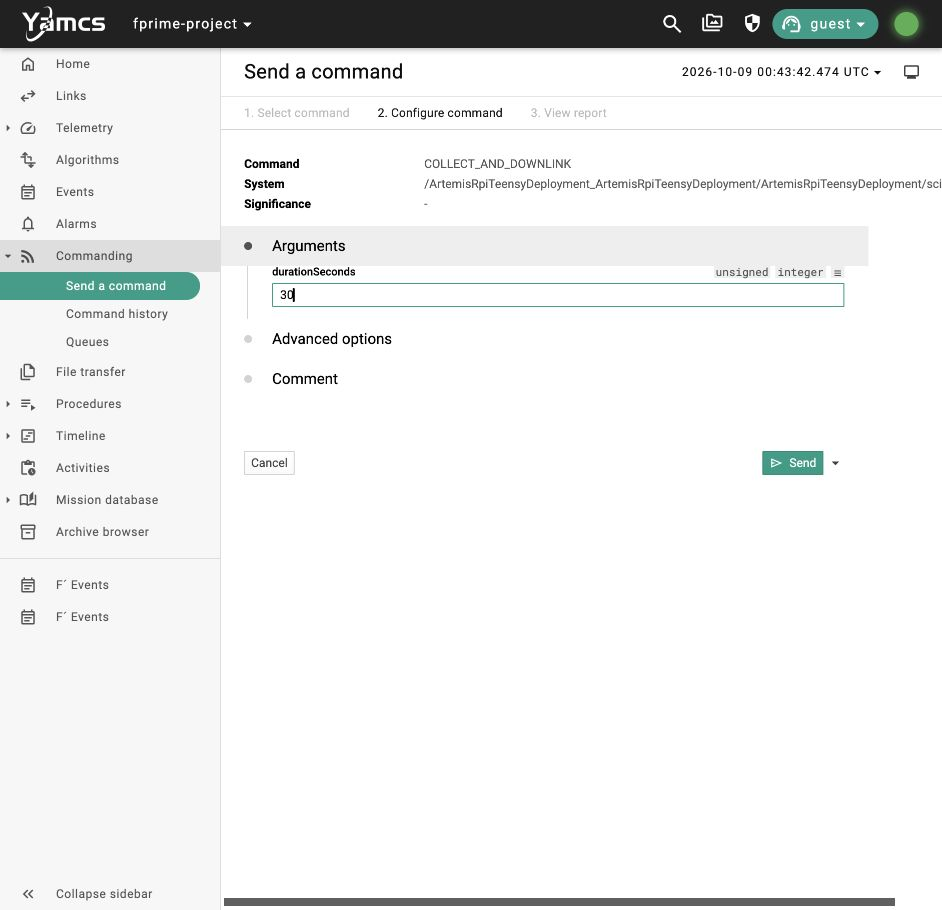
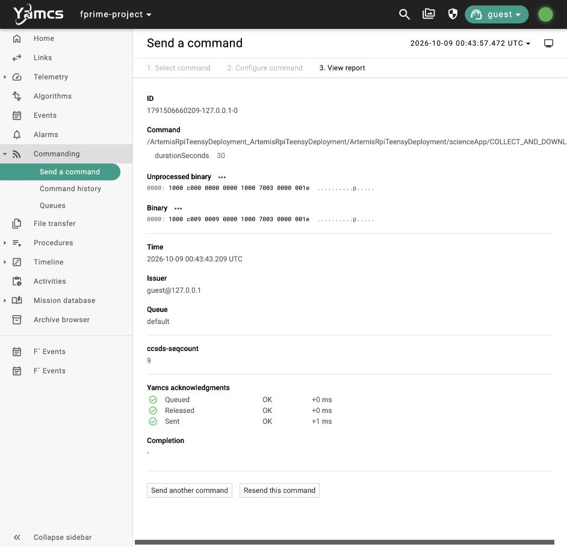
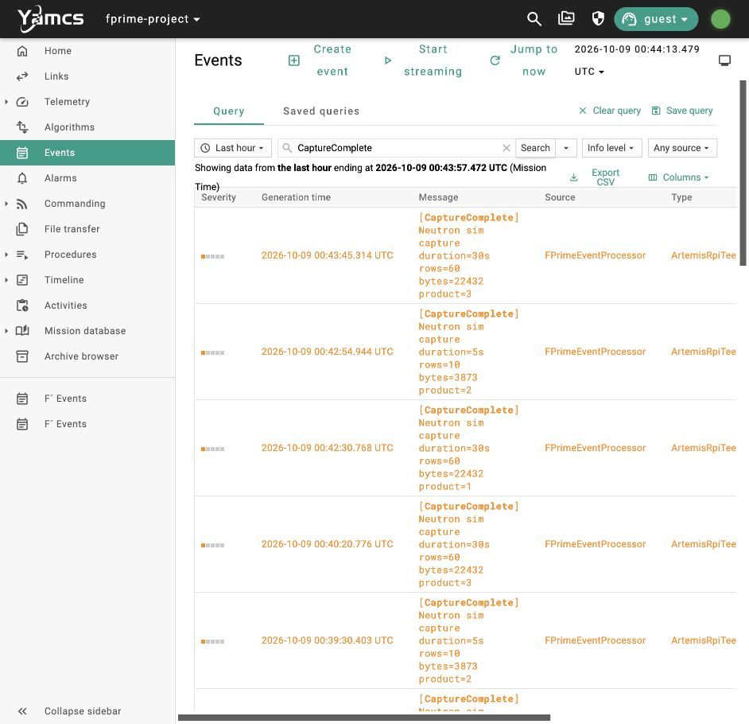
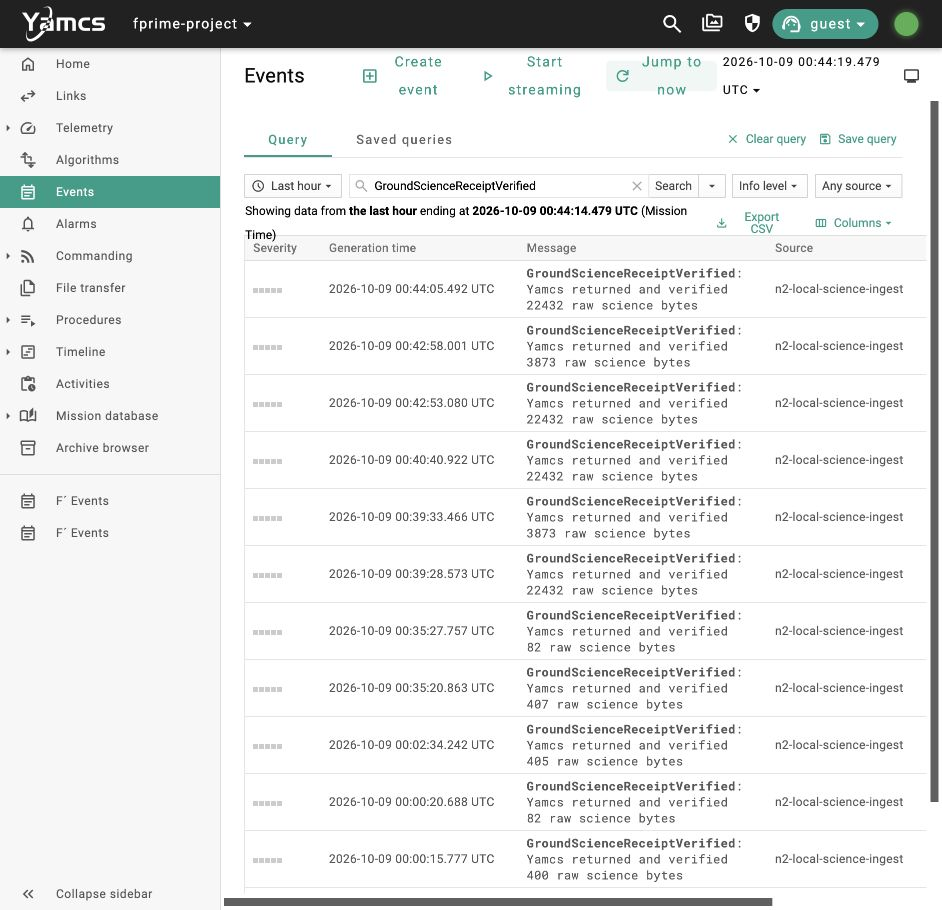
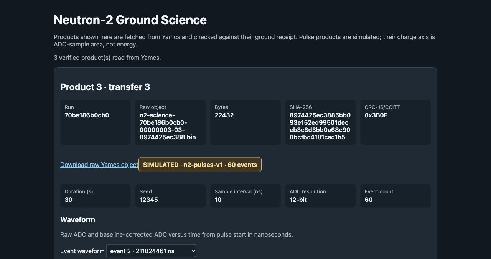
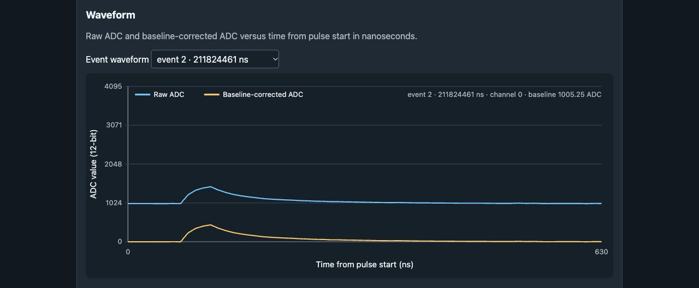
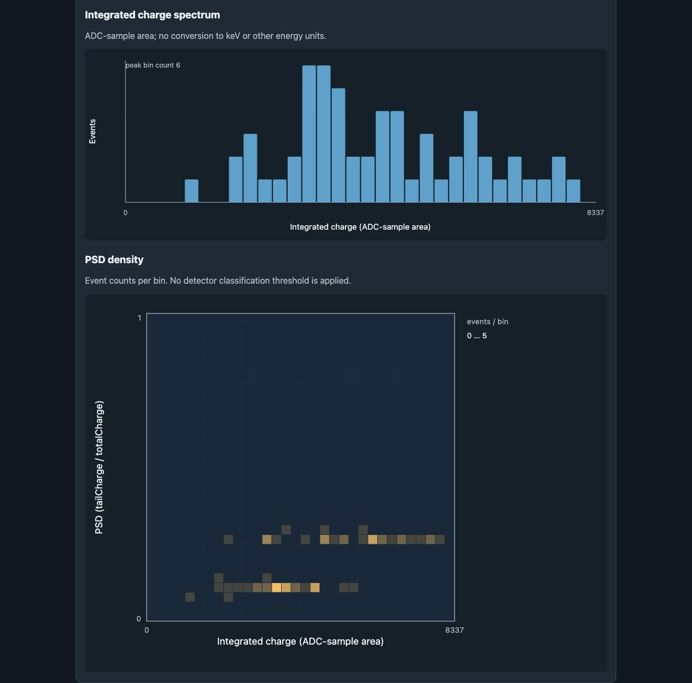

# N2 simulated pulse science operator walkthrough

**Purpose:** command fake detector pulses through Yamcs, receive the verified raw samples, and inspect waveform, spectrum, and PSD on the ground. These are simulated plots in ADC units; figure of merit, real detector calibration, and real payload decoding are deferred. **PASS on October 8, 2026: automated acceptance completed before all seven operator images were captured.**

## Start the software demo

From the `neutron_2` repository root:

```sh
./tools/yamcs/build_native.sh
./tools/yamcs/run_pulses.sh
```

Use one stack at a time. Stop an existing stack with `./tools/yamcs/stop.sh` before changing profiles; wait for its ports to close before restarting. Leave the launcher running. Open <http://127.0.0.1:8090> and choose `fprime-project` / `realtime`. Open the ground viewer at <http://127.0.0.1:8063>.

The pulse profile selects the repository-owned `pulse_sim` source and sends 32 data packets per one-second tick only in the local ON build. Ordinary `run.sh` retains the original count-CSV source and one-packet cadence. Hardware/RF pacing was not changed or tested.

## Operator flow

### 1. Send the collection command

In **Commanding → Send a command**, choose `scienceApp.COLLECT_AND_DOWNLINK`, enter `durationSeconds=30`, and send once. No mode, scheduling, or EPS command is needed.



Yamcs **Queued / Released / Sent OK** confirms dispatch. The command report does not itself confirm capture or ground receipt.



### 2. Confirm the returned capture and receipt

In **Events**, search `CaptureComplete`. A 30-second synthetic exposure produces **60 events**, shown as `rows=60`. In this replay the capture is product `3`, size `22,432` bytes. Also confirm the matching `ScienceStored` and `PayloadDownlinkStarted` product/transfer/size.



Search `GroundScienceReceiptVerified` and click **Jump to now**. Confirm both this event and `PayloadDownlinkComplete`. Sender completion and ground receipt are separate. Match the current run nonce, command time, product/transfer IDs, bytes, and hash; archive events survive restarts. This replay's nonce is `70be186b0cb0` and transfer is `3`.



### 3. Match the raw object and inspect its plots

Refresh the ground viewer. Match product `3`, transfer `3`, run `70be186b0cb0`, size `22,432`, CRC `0x3B0F`, and the SIMULATED banner. The SHA starts `8974425ec388`; the complete hash is recorded below.



Select an event in **Event waveform**. This picture selects event `2`. Blue is raw ADC and yellow is baseline-corrected ADC. The x-axis is time from the pulse start, while the event's timestamp is relative to synthetic exposure.



The **Integrated charge spectrum** bins pulse area in ADC-sample units. **PSD density** uses tail area divided by total area; color counts events in each bin. The two synthetic decay shapes create two ratio populations. Physical energy calibration, particle classification, and figure of merit are deferred.



### 4. Download and retain the raw data

Click **Download raw Yamcs object**. The `.bin` contains `n2-pulses-v1` JSON. This replay's browser download independently matched its receipt SHA, CRC, and size. Retain it with the receipt. Start another collection only after sender completion and verified receipt. No automatic source deletion or positive ground ACK back to F′ is implemented.

The fixed default seed is `12345`. Repeating the same duration and seed yields the same raw sample bytes, with a new product/transfer identity. To exercise another reproducible fixture, set `N2_LOCAL_PULSE_SEED` to an unsigned 32-bit integer when starting the pulse stack. Duration is synthetic exposure; the generator does not wait 30 wall-clock seconds to create the pulses.

## Repeat acceptance

Start a fresh otherwise idle pulse stack with explicit software packet faults:

```sh
N2_LOCAL_SCIENCE_FAULTS=drop-first-0,corrupt-first-1 ./tools/yamcs/run_pulses.sh
```

In a second terminal:

```sh
./tools/yamcs/passthrough.sh
./tools/yamcs/pulse_cycle.sh
```

The probe requests 30- and 5-second exposures (60 and 10 events), verifies packet recovery and invalid/failed capture suppression, independently downloads the raw objects from Yamcs, checks identity/size/CRC/SHA, and recalculates every waveform point, pulse charge/ratio, spectrum bin, and PSD bin. It reads a finalized source file only after ground receipt as an integrity oracle; the ground receiver and viewer never copy the source file. Probe fingerprints must match the stack-start manifest and remain unchanged through acceptance.

The [synthetic pulse plan](N2_SYNTHETIC_PULSE_PLAN_2026-10-08.md) records the versioned fixture and integration gates. The [earlier count-CSV walkthrough](N2_RAW_CYCLE_OPERATOR_WALKTHROUGH_2026-10-08.md) remains the accepted B baseline. This software exercise does not establish Aris's physical interface, Pi Zero W runtime, SatNOGS SPI/SDR/RF, CDR/FSR acceptance, or flight science accuracy.

## Accepted run and evidence

Final run: `yamcs/run/20261008-144213/`, nonce `70be186b0cb0`. Automated `pulse-cycle-fc3dff12dcdd.json` passed at **14:42:59 HST**, then fresh A regression `passthrough-ec29f0f5dfea.json` passed. The UI command `1791506660209-127.0.0.1-0` was released at **14:43:43 HST** (Yamcs displays October 9, 00:43:43 UTC). `operator-pulse-science-ui-verification.json` records the command, correlated admission/completion, capture/storage/downlink/ground receipt, independent calculations, browser download, and seven image hashes/timestamps. Every guide image was taken after automated PASS.

| Capture | Product / transfer | Raw bytes | CRC | SHA-256 |
| --- | --- | ---: | --- | --- |
| Automated 30 s / 60 events | 1 / 1 | 22,432 | `0x3B0F` | `8974425ec3885bb093e152ed99501deceb3c8d3bb0a68c900bcfbc4181cac1b5` |
| Automated 5 s / 10 events | 2 / 2 | 3,873 | `0x6AE0` | `7810380eab0b8f22728ed831ad16b28f786fef8214299b6b740a0b82b3b72836` |
| UI replay 30 s / 60 events | 3 / 3 | 22,432 | `0x3B0F` | `8974425ec3885bb093e152ed99501deceb3c8d3bb0a68c900bcfbc4181cac1b5` |

The first automated transfer repaired one drop and one corruption with one retry request. All waveform points, pulse areas/ratios, 32 spectrum bins, and 32×32 PSD bins matched independent raw-data calculations. Invalid duration and injected capture failure created no successful product/downlink/ground receipt. Fixed-seed repeatability explains why products 1 and 3 have equal raw hashes but different identities.

Native binary SHA: `a56b85a468f471e5c401f4d0c4ed3dc6950fc583dc39707b54c253e1fd5f115c`. Dictionary SHA: `a841a26b99689e5b10ec48d22e61208e2cf369ec39bbc59e314b9f9d53a231b6`. All seven checked source fingerprints match the startup manifest and acceptance evidence. Six component suites passed 31 cases; 16 ground Python cases and five generator cases passed. The viewer's embedded script passed syntax validation, and browser rendering/event selection/download were checked after the page repair. Preliminary images and the user's reference image are excluded from the seven accepted walkthrough images.
