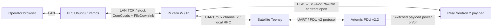
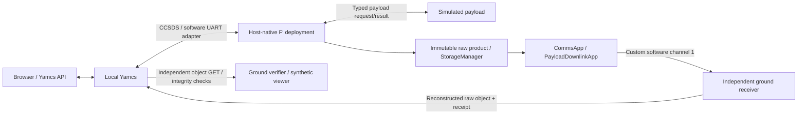

# System Architecture

**BLUF:** Neutron 2's October UNP CDR target is **OBC + payload + PDU**, including PDU-controlled payload on/off and real raw-data acquisition. CDR skips SatNOGS/SDR/RF. The local profile uses stock ComCcsds over TCP between Pi Zero W F′ (stock TCP server) and Pi 5 Yamcs (tcp-fast-client), with stock FileDownlink. Final local native loopback and legacy Yamcs regression checks passed, including both opaque fixtures with independent GET byte/hash checks, fragmentation/disconnect recovery, and fake UART mux channel-2 PDU RPC. The October 27 ARMv6 Pi deployment and real PDU GUI version/readback plus 3V3_1 ON/OFF checks passed; measured voltage, payload readiness and the full collection sequence remain open. See the [live record](../verification/evidence/n2-pdu-deployment-2026-10-27/README.md). Do not add a network mux. The accepted custom channel-1 software demo remains separate from the CDR file path. See the [portable evidence pack](../verification/evidence/n2-cdr-tcp-2026-10-20/README.md).

Updated October 27, 2026; incorporates the selected TCP/FileDownlink path and bounded live PDU acceptance. The implementation builds on `neutron2-develop` source baseline `5429a2f`; use the linked CDR evidence pack for exact modified source/dictionary identity. [Development intent](../planning/DEVELOPMENT_INTENT.md) owns milestone scope; [software baseline](../verification/SOFTWARE_BASELINE.md) owns historical acceptance. Dennis confirmed the USB↔RS-422 payload interface, Pi Zero W/Teensy satellite split, and Pi 5 Ubuntu/Yamcs LAN host. SatNOGS firmware/SPI and SDR are FSR scope. Electrical settings and payload protocol details below remain open where unspecified.

## Purpose

Neutron 2 is the mission; the Artemis CubeSat Kit supplies the prototype bus for the FlatSat demonstration. This checkout's N2 architecture does not select a new reusable Artemis kit architecture or replace the separate C3M/Zephyr baselines. A host simulation, target build, integrated FlatSat demo, and flight qualification are different evidence levels.

The spacecraft F′ deployment runs on the satellite Pi Zero W. The Teensy remains its embedded bridge/local-control partner. A separate Pi 5 running Ubuntu hosts Yamcs and F′ ground services; CDR uses its tcp-fast-client, while FSR adds SDR services. Students use the web interface over the local network. The ground host does not run a second spacecraft mission authority. Pi Zero W is the selected SatNOGS SPI controller; harness and firmware interface details remain TBD.

## UNP milestone scope

| Requirement | October 2026 CDR | December 2026 FSR |
| --- | --- | --- |
| Core systems | PLD, OBC, PDU | PLD, OBC, PDU, COMMS, SDR and Yamcs ground |
| Operator | Pi Zero W F′ stock TCP server ↔ LAN ↔ Pi 5 Yamcs tcp-fast-client; browser operators on LAN | Yamcs via Pi 5 Ubuntu/LAN |
| Trigger | Direct CCSDS commands/events/telemetry; stock FileDownlink returns files | Previously planned scheduled collection at time X through COMMS |
| Payload interface | USB↔RS-422 command/telemetry; raw-product transfer contract to be agreed | Same payload contract within the full chain |
| Power | PDU-controlled payload power-on/off | Integrated PDU power/readiness/collection/shutdown sequence |
| Mission modes | Formal modes/scheduling not required by the revised CDR scope | Previously planned nominal Base/collection/processing flow and return to Base |
| Science result | Target: retain raw product on OBC, send with stock FileDownlink, and independently check ground bytes by size/hash | Independently received/verified raw science on the ground |

**October 20 transport selection:** CDR retains payload/PDU power on/off and raw acquisition, while SatNOGS/SDR/RF is deferred to FSR. Use stock ComCcsds over TCP and stock FileDownlink; do not add a network mux or claim radio-like chunk/retry behavior. The physical UART mux channel 2 remains for PDU RPC. Final native loopback and legacy Yamcs regression checks passed; see the [canonical plan](../planning/CDR_TCP_YAMCS_IMPLEMENTATION_PLAN.md), [runbook](../operations/CDR_TCP.md), and [portable evidence pack](../verification/evidence/n2-cdr-tcp-2026-10-20/README.md). ADCS/D2S2 HIL, geo-based commanding and additional flight modes remain below the core FSR sequence.

## High-Level Architecture

### CDR payload/PDU target

Use the stock F′ TCP server on the Zero W and the Pi 5 Yamcs tcp-fast-client. The ground `cdr_comm_bridge` composes stock `TcpFastClientAdapter` and `UdpFastAdapter` with the TM frame aggregator and PacketBridge, plus a small 5 ms UDP pacing wrapper for outgoing TM. FileDownlink remains stock; no source scheduler change or network mux is needed. Final local tests independently verified both fixture transfers, fragmentation/disconnect recovery, and fake channel-2 PDU RPC. The physical UART mux channel 2 stays connected to the Teensy/PDU RPC path. See the [canonical plan](../planning/CDR_TCP_YAMCS_IMPLEMENTATION_PLAN.md), [runbook](../operations/CDR_TCP.md), and [evidence pack](../verification/evidence/n2-cdr-tcp-2026-10-20/README.md). No SatNOGS/SDR/RF link is required for CDR.

### FSR full FlatSat hardware and ground

```mermaid
flowchart LR
    Browser["Operator browser"] <-->|"LAN"| Ground["Pi 5 Ubuntu / Yamcs"]
    Ground <-->|"USB / team-owned SDR software"| SDR["USRP B200"]
    SDR <-->|"UHF conducted RF / SMA-coax"| Radio["Separately powered SatNOGS-COMMS v0.3.2 PHASMA PC104"]
    Radio <-->|"SPI breakout / 6-pin Molex-to-PC104 harness; pinout TBD"| OBC["Pi Zero W / F′ custom SatNOGS driver"]
    OBC <-->|"USB ↔ RS-422; raw-file contract open"| PLD["Real Neutron 2 payload"]
    OBC <-->|"UART mux channel 2 / local RPC"| Teensy["Satellite Teensy"]
    Teensy <-->|"UART / PDU protocol v2"| PDU["Artemis PDU hardware v2.2"]
    PDU -->|"Payload power on/off"| PLD
```

Links show system responsibilities, not a pinout or an implemented driver. The Pi Zero W runs the F′ binary and retains mission authority; the Teensy provides the embedded half of the OBC split. USB↔RS-422 is the selected payload connection; exact adapter, connector, electrical settings, and the payload-side raw-file boundary must be recorded before implementation. Pi Zero W is the selected SatNOGS SPI controller; the Teensy retains local PDU duties.

Sam and Zach own SatNOGS firmware/SPI and SDR work. Dennis owns OBC F′, Yamcs integration, and the F′ SatNOGS component/driver. Aris owns the payload. Agree the interfaces across those ownership boundaries before substituting hardware. [Payload contract](../integration/PAYLOAD.md) · [SatNOGS/SDR contract](../integration/SATNOGS.md) · [Ground host](../integration/GROUND_HOST.md).

### Implemented local software path

This profile runs on one macOS host, with pseudo-terminals in place of board UARTs and no RF packetization. It proves software behavior, not USB↔RS-422, Pi target runtime, SPI, or SDR compatibility. Moving to the FlatSat keeps the ownership model but requires real device/ground adapters and target validation.

## Demo Operating Story

### October CDR: payload collection and PDU on/off

1. Command/observe Pi Zero W F′ from Pi 5/Yamcs over stock ComCcsds/TCP. The local native profile passes; Pi Zero W and Pi 5 deployment checks remain open.
2. OBC commands the PDU to turn the payload on. Observe power/readback and payload readiness using the agreed hardware indicators and timing.
3. Command the real payload over USB↔RS-422 to collect for the requested duration. Distinguish acceptance from collection completion and report failure truthfully.
4. Validate and retain the complete raw product on the OBC. Use stock FileDownlink to send the selected file and independently verify the received bytes, size and hash before removing payload power. A missing or partial ground file is not success.
5. Command the PDU to turn payload power off and verify the off state.
6. Confirm Yamcs readback matches the retained product's identity, size and integrity. Keep the onboard copy; the payload team's JAR owns actual science interpretation.

The required demo is real payload + PDU integration plus stock ComCcsds/FileDownlink over TCP. SatNOGS, SDR and RF downlink are deferred to FSR. Formal mission modes and scheduling remain outside the CDR requirement; PDU control/readback, payload startup/shutdown, and independent received-file verification are in scope. Local fake-interface tests do not establish real payload or PDU acceptance. Stock FileDownlink completion events alone do not establish ground receipt.

### December FSR: scheduled mode and power sequence

1. Start in Base Mode. Yamcs schedules collection for time X through the full ground → SDR → SatNOGS → OBC COMMS path added for FSR.
2. At time X, F′ sequences EPS payload power and readiness, then enters the agreed collection state and starts acquisition.
3. After the requested duration, transition PLD to standby/processing and retrieve the complete raw product.
4. Validate and commit the onboard copy before powering the payload off. Return the system to Base with the product retained.
5. Downlink through SatNOGS/SDR and independently verify ground receipt in Yamcs; show the recorded scheduling, mode and power transitions.

This is the target behavior. Existing demo mode/scheduling code is a starting point, not evidence that this integrated FSR sequence exists. Exact mode names, absolute UTC versus relative time X, clock validity, startup/settling delays, power readback, cancel/restart and lost-link behavior still need agreement. Failure must produce a truthful terminal result and the agreed recovery behavior rather than a false science/delivery success.

## Flight Software Architecture: Application → Manager → Driver (HAL)

Keep mission policy above device protocols. F′'s [Application-Manager-Driver pattern](../../ArtemisRpiTeensy_N2/lib/fprime/docs/user-manual/design-patterns/app-man-drv.md) provides the design guide. The actual [topology](../../ArtemisRpiTeensy_N2/ArtemisRpiTeensyDeployment/Top/topology.fpp) and [shared types/ports](../../ArtemisRpiTeensy_N2/Components/Types/Types.fpp) own current connections.

| Owner | Current responsibility | Hardware integration boundary |
| --- | --- | --- |
| `MissionApp` | Mode ownership/transition guard; mission commands | Extend nominal FSR coordination without moving mission authority to the ground or Teensy |
| `ScienceApp` | Capture scheduling/execution, matched operation outcomes, collection/downlink orchestration | Coordinate agreed PLD/EPS readiness and completion |
| `PayloadManager` | Sole admission/serialization point for payload operations | Keep shared request/generation/outcome semantics across the real driver |
| `PayloadDriver_NeutronSim` | Synthetic literal echo and simulator acquisition | Real USB↔RS-422 driver must implement the agreed public PLD contract |
| `StorageManager` | Validate/retain immutable raw products and metadata; recover/select catalog entries | Retention, capacity and target filesystem evidence |
| `CommsApp` | Delivery requests, product/transfer correlation and sender outcome | Real transport integration must retain truthful outcome semantics |
| `PayloadDownlinkApp` | Current custom science packet sender and retry path | SatNOGS/ground adaptation is not established by the existing sender |
| `EpsManager` / `EpsDriver_Artemis` | Generic EPS operations / PDU v2 through satellite-local RPC | Actual payload rail, on/off/readback and timing for CDR; integrated scheduling/mode behavior for FSR |
| Ground receiver/verifier | Reconstruct raw bytes; verify Yamcs readback; update VERIFIED command history | SDR science routing, object ingestion, and independent receipt |

Applications also coordinate framework services and delivery components according to topology; the tier names do not mean every packet traverses all three tiers. Hardware substitution should preserve stable contracts where possible. A new driver is not a guarantee of zero manager/topology changes: real payload and radio requirements may expose missing interface semantics.

October 26 PDU readability: `EpsManager` adds named rail commands and nine
`UNKNOWN`/`OFF`/`ON`/`STALE` channels. `EpsDriver_Artemis` validates replies,
emits named results/errors and publishes per-rail freshness through
`EpsRailSnapshot`. The legacy EPS port and PDU/Teensy wire protocol remain
unchanged. Rebuild F′ and its matching Yamcs dictionary together; this local
slice requires no PDU firmware flash. See the [operator/local QA guide](../operations/PDU_READABILITY.md).

### Payload lifecycle

All payload entry points share one arbiter. One operation may be active; competing valid requests receive `BUSY`. Admitted operations carry request ID plus internal generation and produce `ACCEPTED` followed by one terminal result. Failure, timeout, unavailability, and stale/duplicate callbacks cannot create a successful collection or second science product. A successful literal echo creates no science product.

The simulator's worker cleanup and recovery were tested locally. The real driver must define equivalent timeout/cancel/recovery behavior against PLD responses; no private opcode meaning or hardware timing should be inferred from the simulator. See [lifecycle evidence](../operations/walkthroughs/LIFECYCLE.md).

### Raw storage and completion

FSW handles opaque raw science. `StorageManager` commits immutable copies with versioned metadata under `N2_STORAGE_ROOT`, validates size/CRC, and recovers valid catalog entries after process restart. Persistent identity allocation prevents product-ID reuse. The current catalog holds 16 products, rejects new captures when full, and retains delivered products; automatic ACK-based reclamation and power-loss qualification are deferred.

For local operations, `scienceApp.VERIFIED_COLLECT_AND_DOWNLINK` and `commsApp.VERIFIED_REQUEST_SCIENCE_DOWNLINK` use unique nonzero tokens. Yamcs command history records `PayloadAccepted`, `PayloadTerminal`, `StorageCommitted`, `SenderComplete`, `GroundReceipt`, and `CommandComplete` as applicable. Final success requires independent raw-object readback matching identity, size, CRC and SHA-256. Sender DONE and ordinary F′ opcode completion are insufficient. See [completion/storage acceptance](../verification/COMPLETION_STORAGE.md).

The accepted custom science channel and stock FileDownlink are separate paths. Custom channel-1 VERIFIED acceptance remains local software evidence; do not silently migrate it or claim its semantics for stock FileDownlink. CDR uses stock FileDownlink over TCP and requires separate independent ground-file verification. The later SatNOGS/SDR path needs its own interface and receipt evidence.

## OBC Detail

The selected demo split remains **Pi Zero W F′ mission computer + Teensy embedded bridge/local services**. The planned Pi 5 Ubuntu machine is ground equipment. Local emulation temporarily runs the spacecraft binary on the development host; it is not the target placement.

`ArtemisRpiTeensy_N2/` owns F′. `ArtemisTeensy_N2_Baremetal/` and `GDS_Teensy/` preserve the earlier satellite/ground RFM23BP firmware. CDR uses the satellite Pi/Teensy split without requiring a ground Teensy or radio chain. Pi Zero W owns SatNOGS SPI; MCU endpoint, harness and reset/ready details remain to be agreed.

The longer-term N2 iOBC target is separate from this Pi Zero W FlatSat proxy. This document claims no iOBC port or qualification.

## Satellite UART Architecture: Three Local Channels

The physical Pi Zero W ↔ Teensy connection uses `LinuxUartDriver` ↔ `UartChannelMux` with the contract in [`config/transport_constants.json`](../../config/transport_constants.json). Generate/check headers from the JSON; do not hand-edit generated constants. This UART is separate from CDR's initially tested Pi Zero W ↔ Pi 5 ComCcsds/TCP path; the software/legacy channels below are not TCP network-mux channels.

| Logical channel | Current role | Scope |
| --- | --- | --- |
| 0 | CCSDS commands, events and telemetry | Local Yamcs software bridge; prior RFM23BP RF path |
| 1 | Custom raw-science packets and recovery | Independent local receiver; prior RFM23BP science sidecar |
| 2 | Satellite-local RPC, including PDU v2 | Consumed locally; never forwarded as raw RF traffic by the prior bridge |

These are current software/legacy UART channels, not SatNOGS SPI endpoints or an SDR ICD. Real USB↔RS-422 payload traffic must have its own device contract; it is not automatically a new RF channel.

### The three ground USB serial ports

The older ground Teensy exposes GDS, debug, and payload serial ports. USB port index 2 carries science from logical RF channel 1; it is not satellite-local RPC channel 2. See the [historical transport details](../archive/legacy-gds-rfm23bp/SYSTEM_ARCHITECTURE_BEFORE_UNP_REFRESH.md#the-three-ground-usb-serial-ports). This triple-serial layout is not the planned Pi 5/SDR ground interface.

## Build profiles and current evidence

F′ is pinned to v4.2.1 (`a750219`); the PDU reference is `e94ee06` (firmware 2.2.2, `codex/n2-cdr-pdu`). The [deployment CMake](../../ArtemisRpiTeensy_N2/ArtemisRpiTeensyDeployment/CMakeLists.txt) selects `LocalYamcsConfig` when `NEUTRON2_LOCAL_YAMCS=ON` and `RfMvpConfig` otherwise. The option defaults OFF.

The local profile uses 512-byte framework communication buffers, 1024-byte TM frames and 504-byte generated command/fixed-string constants. Individual commands retain their own declared limits; synthetic pass-through uses a 128-byte printable-ASCII contract. These capacities are host-test choices, not agreed PLD/radio limits. The [Yamcs build helper](../../tools/yamcs/build_native.sh) selects ON explicitly. Re-run it after UTs before local replay because native and UT installs share artifacts. Never deploy the macOS host artifact to the Pi or infer that OFF is a validated SatNOGS configuration.

| Evidence | Established | Remaining boundary |
| --- | --- | --- |
| July frozen MVP | Historical Pi/Teensy/RFM23BP simulated-payload HIL | Different radio/ground path; not UNP CDR acceptance |
| October 8–14 local acceptance | Synthetic A/C/B, pulse science, durable storage and VERIFIED completion; packaging regressions | Exact scenarios and dated fingerprints in [baseline](../verification/SOFTWARE_BASELINE.md) |
| October 18 setup rerun, source `5429a2f` | Native ON build; six component suites; 26 Python tests; transport consistency; Yamcs PING, pass-through and two pulse/raw-readback captures with invalid/failure cases | Host-only; not every historical lifecycle/restart scenario was replayed |
| October 20 CDR local loopback | Final native F′/Yamcs run passed both opaque fixture transfers with independent GET equality/SHA, fragmentation/disconnect recovery, missing-file error/no-object behavior, source/product helper, and 41 fake channel-2 RPCs; guard tests, startup cancellation, and legacy regressions also passed | No Pi, payload, or PDU hardware proof |
| Current UNP hardware integration | Selected interfaces and ownership documented | Pi Zero W ARMv6 runtime, Pi 5 LAN deployment, payload wiring/protocol, PDU power/readiness, SatNOGS/SPI, SDR routing, and complete CDR/FSR sequence still need proof |

October 18 evidence is local/ignored under `yamcs/run/20261018-145218/`; portable historical packages remain under [verification evidence](../verification/evidence/). See [README setup](../../README.md#local-setup-and-demo) for the pinned CMake wheel metadata caveat observed on that host.

## Ground Segment

CDR uses the Pi Zero W stock F′ TCP server ↔ LAN ↔ Pi 5 Yamcs tcp-fast-client path; final local native loopback passed. Pi 5/Yamcs is therefore part of CDR; SDR/SatNOGS RF is added for FSR. The stock ground bridge uses TCP/UDP adapters, frame aggregation, PacketBridge, and 5 ms TM pacing. Manual stock FileDownlink and the source/product helper both have local transfer evidence with independent received-byte checks.

The Pi 5 Ubuntu host runs Yamcs/F′ ground services, archives telemetry/events and received science, and serves operator browsers on the router LAN. For FSR it also connects to the SDR. Sam and Zach own the SatNOGS/SDR work; Dennis integrates the Yamcs handoff. The frame-versus-packet boundary, identifiers, framing, error checks, and science reconstruction must be agreed end to end.

The existing simulator launcher binds `127.0.0.1` and starts both simulated spacecraft and ground services. The separate CDR ground-only launcher has final local loopback acceptance; startup cancellation exited in 0.444 seconds with both exact process groups gone. Pi 5 deployment still needs a supported runtime, resource/heap budget, LAN binding/access controls, service/restart configuration, persistence, and multi-client checks. See [ground-host plan](../integration/GROUND_HOST.md).

FSW returns raw files. Aris's payload JAR owns actual science interpretation. The local synthetic viewer independently retrieves Yamcs objects and plots count-frequency or simulated pulse waveform/charge/PSD views; its schema and units are not the real payload ICD or calibrated detector science.

## Hardware decisions and acceptance gates

| Boundary | Confirmed October 18 | Still needed before acceptance |
| --- | --- | --- |
| PLD ↔ OBC | USB↔RS-422 command/telemetry; Aris + Dennis interface | Adapter/connector/pinout, electrical/serial settings, public command and duration units, readiness/response correlation, raw-product framing/retrieval/integrity and timeout behavior |
| SatNOGS ↔ OBC | Pi Zero W SPI controller; PHASMA v0.3.2; Sam/Zach firmware, Dennis F′ driver | Populated board and firmware identity, SPI mode/clock, CS/reset/ready/IRQ, MCU packet endpoint, queues/backpressure and recovery |
| SDR ↔ Yamcs | USRP B200 over USB; Sam/Zach handle SDR; Pi 5 Ubuntu ground host | Team-owned demodulation and software frame/packet handoff; raw-science receipt |
| PDU ↔ PLD/OBC | Artemis hardware v2.2, protocol v2; Pi UART mux → Teensy → UART → PDU, reported mostly wired | Actual EPS/PDU board and payload rail, harness/readback, power budget, startup/shutdown timing, safe fault response |
| Mission Ops | CDR payload/PDU without COMMS; FSR full chain | CDR operator access/command path, Yamcs role, local raw-product inspection; exact review dates and FSR time/mode/cancel/restart/lost-link rules |

Progress through these gates: agree payload/PDU and operator contracts → fake-transport tests → target build/runtime → authorized wired PLD/OBC/PDU integration → CDR payload on/collect/retain/off demonstration. Then add MCU/SPI and SDR/Yamcs integration → reviewed conducted RF → FSR full-chain command/raw-data and scheduled mode/power sequence. Record conducted and antenna tests separately. Use exact board, firmware, binary/dictionary and received-product identity for every hardware record. Hardware activity requires its applicable runbook and task-specific authorization; this is a documentation update.

## Historical comparison interfaces

The [pre-refresh architecture](../archive/legacy-gds-rfm23bp/SYSTEM_ARCHITECTURE_BEFORE_UNP_REFRESH.md) preserves detailed July-era transport, RF sizing and GDS rationale. It is historical where it treats RFM23BP as the default or Yamcs/SatNOGS as future work. Current N2 mission ops starts at the [quickstart](../operations/QUICKSTART.md).

### The RF Link Constraint: How fprime-gds Talks Over a Walkie-Talkie

The old RFM23BP path segmented small packets, constrained CCSDS frames and throttled telemetry. Its constraints do not establish SatNOGS throughput or limits. [Historical rationale](../archive/legacy-gds-rfm23bp/SYSTEM_ARCHITECTURE_BEFORE_UNP_REFRESH.md#the-rf-link-constraint-how-fprime-gds-talks-over-a-walkie-talkie).

### RF MVP Config Overrides (a landmine to know about)

The OFF/RF profile retains the old small-buffer configuration in `RfMvpConfig`; the ON/local profile uses `LocalYamcsConfig`. Advice about the old 128-byte frames and 80-byte log strings is profile-specific. [Historical overrides](../archive/legacy-gds-rfm23bp/SYSTEM_ARCHITECTURE_BEFORE_UNP_REFRESH.md#rf-mvp-config-overrides-a-landmine-to-know-about).

### End-to-End Example: Tracing a Command and a Telemetry Channel

In the accepted host-native local profile, PING travels Yamcs → software UART/mux channel 0 → `ComCcsds` → `CdhCore.cmdDisp` → `missionApp.PING`; Pong returns through the event/CCSDS path to Yamcs. CDR instead targets direct stock ComCcsds/TCP between the Zero W and Pi 5. [Historical RF trace](../archive/legacy-gds-rfm23bp/SYSTEM_ARCHITECTURE_BEFORE_UNP_REFRESH.md#end-to-end-example-tracing-a-command-and-a-telemetry-channel) adds the old ground/satellite Teensy hops. The SDR/SatNOGS trace must be proven separately for FSR.

### D2S2: Orbit / Pass-Timing Simulator

D2S2 belongs to the earlier pass-timing/ADCS demo context. It is not a CDR requirement or an established hardware source for the current collection trigger. [Historical explanation](../archive/legacy-gds-rfm23bp/SYSTEM_ARCHITECTURE_BEFORE_UNP_REFRESH.md#d2s2-orbit--pass-timing-simulator); current mode ownership is described in [mission modes](MISSION_MODES.md).

## Reference Documents

- [Development intent](../planning/DEVELOPMENT_INTENT.md), [SDD gap plan](../planning/SDD_GAP_PLAN.md), and [mission modes](MISSION_MODES.md).
- [Local Yamcs runbook](../development/YAMCS_LOCAL_TESTING.md), [operator quickstart](../operations/QUICKSTART.md), and [software baseline](../verification/SOFTWARE_BASELINE.md).
- [PDU payload power](../integration/PDU.md), [payload](../integration/PAYLOAD.md), [SatNOGS/SDR](../integration/SATNOGS.md), and [ground host](../integration/GROUND_HOST.md) contracts/plans.
- [PDU v2 ICD](../../external/artemis-pdu/PDU_PROTOCOL_ICD.md): implementation-owned protocol reference, not a populated-board acceptance record.
- [Artemis references](../reference/artemis/README.md), [original SDD](../reference/sdd/README.md), and [glossary](../reference/GLOSSARY.md).
- [Frozen GDS/RFM23BP runbooks](../archive/legacy-gds-rfm23bp/README.md): comparison evidence and revision-matched bench instructions.
