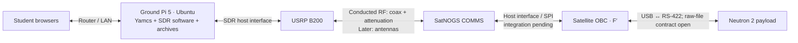

# Neutron 2 dedicated Yamcs ground host

Plan recorded October 8, 2026; allocation, transport and ownership updated October 19, 2026.

**BLUF:** Use a Raspberry Pi 5 running **64-bit Ubuntu Linux** as the dedicated ground-station host. It runs Yamcs, keeps ground archives and received files, and connects to an SDR. Students join the router's LAN and use Yamcs in a browser; operating the station does not require a local repository, Java, or Yamcs installation. This is recorded intent and a deployment plan, not an implemented or accepted Pi deployment.

For the concepts behind this plan, read the [Yamcs primer](../operations/YAMCS_BASICS.md). For the existing software test environment, use the [local Yamcs runbook](../development/YAMCS_LOCAL_TESTING.md).

## October 18 milestone allocation

The full Pi 5/Yamcs/SDR ground chain below is the **FSR target**. Revised CDR scope is OBC + real payload + PDU power-on/off and skips COMMS. CDR command/telemetry uses Pi Zero W F′ TCP over the local network to Pi 5 Ubuntu/Yamcs, with operator browsers on the LAN. This is the selected direction, not implemented or hardware-tested TCP support. The local simulator remains useful development evidence, not a selected CDR operating procedure.

## October 18 allocation confirmation

Dennis reaffirmed the satellite **Pi Zero W F′ deployment binary + Teensy embedded split**, with a separate **Pi 5 Ubuntu host for Yamcs/F′ ground services** accessed by browsers over the router LAN. Sam and Zach handle SatNOGS firmware/SPI and SDR; Dennis integrates F′/Yamcs. PLD↔OBC command/telemetry uses USB↔RS-422; raw-file details remain open. This confirms the intended roles, not a purchase, deployment, wiring or RF acceptance. The dated shopping list below remains historical.

## Pi shopping list — October 8, 2026

**Budget target: Raspberry Pi 5 4GB, $156.80 for the complete host before tax and shipping to Hawaiʻi.** Dennis prefers buying a suitable host rather than working around the existing 1GB Pi 3. The 8GB Pi 5 is an optional $65 upgrade for additional memory headroom; it is not a measured requirement. No purchase has been made.

Prices below are PiShop US listings checked October 8, 2026. Recheck price and availability before ordering. Quantity is one of each item.

| Item | Price (USD) | Purpose |
| --- | ---: | --- |
| [Raspberry Pi 5, 4GB](https://www.pishop.us/product/raspberry-pi-5-4gb/) | $110.00 | Dedicated Ubuntu/Yamcs ground computer. |
| [Official 27W USB-C power supply, US plug](https://www.pishop.us/product/raspberry-pi-27w-usb-c-power-supply-white-us/) | $12.95 | Pi 5 power supply; USB-C power cable is part of the supply. |
| [Official Pi 5 case, black/grey](https://www.pishop.us/product/raspberry-pi-case-for-pi-5-black-grey/) | $10.95 | Enclosure with included cooling fan; do not add a second cooler to this budget. |
| [64GB blank SanDisk Ultra microSD](https://www.pishop.us/product/microsd-card-64-gb-class-10-blank/) | $19.95 | Ubuntu, runtime software, and initial archives/files. |
| [5ft Cat6 Ethernet cable](https://www.pishop.us/product/5ft-cat6-ethernet-cable-black/) | $2.95 | Connect the Pi to the existing router. Choose a longer cable if the bench requires it. |
| **Complete Pi 5 4GB host** | **$156.80** | **Board plus power, enclosure/cooling, storage, and LAN cable.** |

Reusing a suitable microSD and Ethernet cable saves $22.90, making the 4GB host $133.90 before tax/shipping. Reuse an SD reader/adapter for flashing, or obtain one separately if none is available. A monitor, keyboard, and HDMI cable are not required for normal headless operation. Ubuntu Server and Yamcs add no software purchase cost. Use a fresh **64-bit Ubuntu Server** installation; the exact supported release remains to be selected and validated.

### Purchase alternatives

| Alternative | Board price | Complete host | Assessment |
| --- | ---: | ---: | --- |
| Pi 4 4GB | $100.00 | $144.60 | Only $12.20 below the Pi 5 setup; listed as “Notify Me” when checked. Consider a used/borrowed Pi 4 if it provides meaningful savings. |
| **Pi 5 4GB** | **$110.00** | **$156.80** | **Recommended budget shopping target.** |
| Pi 5 8GB | $175.00 | $221.80 | Optional memory headroom for concurrent services and larger workloads. |

Board-price source: [PiShop current Pi listings](https://www.pishop.us/product-category/raspberry-pi/raspberry-pi-boards/current-pi-boards/). The Pi 4 comparison uses its [official 15W supply ($8.80)](https://www.pishop.us/product/raspberry-pi-15w-power-supply-us-white/), [official case ($5.95)](https://www.pishop.us/product/raspberry-pi-4-case-black-grey/), [case fan/heatsink ($6.95)](https://www.pishop.us/product/case-fan-heatsink-for-raspberry-pi-4-case/), and the same microSD and Ethernet cable: $44.60 in accessories. Pi 5 accessories total $46.80.

**Scope:** host hardware only, assuming an existing router and student laptops. SDR and RF equipment are handled separately and are excluded from this shopping list. An SSD is a later archive/storage upgrade, not part of the initial purchase. Validate memory use and storage growth under representative operation before deciding on upgrades; the current launcher needs heap tuning for a 4GB host.

## Decisions recorded from Dennis

| Decision | Intended behavior |
| --- | --- |
| Ground computer | Dedicated Raspberry Pi 5 with Ubuntu Linux; use a 64-bit/aarch64 installation. |
| Network | Connect the Pi to a router. Students reach it over the local network; SSH is available for maintainers. A stable address or lab hostname should identify the station. |
| Student interface | Browser access to the Pi-hosted Yamcs web interface. Students developing F′ still need their development tools; station operators do not. |
| Ground radio | Connect the Pi 5 to the SDR through the SDR's supported host interface, USB to the USRP B200. Sam and Zach handle SDR implementation and demodulation; agree the software handoff contract. |
| First radio connection | Connect the SDR's appropriate RF port(s) to the SatNOGS COMMS board over coax with a reviewed attenuation/port arrangement. This is a conducted RF test, not a digital cable bypass. |
| Later radio connection | Substitute the agreed antenna/radio path for the conducted connection, keeping the ground packet handoff consistent where possible. |
| Spacecraft software | Current native F′ deployment is the simulated spacecraft in the board-free testbed. For hardware operation, F′ runs on the satellite OBC; the current CDR OBC intent is Pi Zero W. The ground Pi 5 is a separate computer. |

## Intended system

Yamcs already serves its web interface, HTTP API, and WebSocket updates. Students would open `http://<ground-pi-lan-address>:8090` for the initial LAN deployment. This is an example URL, not a currently reachable station. Normal browser use does not require SSH or a separate client installation. [Official HTTP server documentation](https://docs.yamcs.org/yamcs-server-manual/services/global/http-server/)

## SDR-to-Yamcs handoff

No separate custom decoder is required merely because the source is an SDR. If the SDR team's software delivers compatible CCSDS frames or packets through a supported Yamcs link, the existing Yamcs/F′ integration handles the next layers. The SDR modem and packet-output functions can be part of that team's software, rather than another project owned by Dennis.

Agree what the SDR output actually contains: demodulation alone may still leave channel coding, synchronization, radio envelopes, or fragmented data to recover. Deliver the agreed frame/packet bytes after the necessary recovery and decapsulation; retain the headers and CRC expected by the selected Yamcs link.

The present [instance configuration](../../yamcs/config/etc/yamcs.fprime-project.yaml) provides this **local software baseline**, not a hardware ICD:

| Direction/service | Current setting | Proposed initial handoff |
| --- | --- | --- |
| Telemetry into Yamcs | `UdpTmFrameLink`, UDP `50000`; TM frames, 1024 bytes, spacecraft ID 68, VC 1, CRC16 | SDR software sends one complete compatible TM frame per UDP datagram to this configured input. |
| Commands toward ground transmitter | `UdpTcFrameLink`, destination `localhost:50001`; spacecraft ID 68, VC 1, CRC16, maximum frame length 1024 | SDR software receives Yamcs-generated TC frames and performs the agreed radio transmission. This is a maximum, not a promise that every TC frame is 1024 bytes. |
| Internal telemetry helper | UDP `50002`, `fprime-yamcs-tlmchan` | Remains part of the existing F′ telemetry integration; this is not a second SDR input requirement. |
| Payload decoding | `FprimePacketPreprocessor` and generated XTCE mission database | Use the dictionary matching the actual spacecraft binary and configured F′ types. |

If the SDR instead outputs bare CCSDS space packets, select a packet link. A TCP stream of consecutive CCSDS packets can use Yamcs's built-in `CcsdsPacketInputStream`; its length field separates packets. Do not send bare space packets to a link expecting TM transfer frames. Frame size, identifiers, coding, encapsulation and segmentation must be selected with the hardware team; the simulator's 1024-byte profile is not automatically suitable for SatNOGS. [Frame processing](https://docs.yamcs.org/yamcs-server-manual/links/ccsds-frame-processing/), [CCSDS packet stream](https://docs.yamcs.org/yamcs-server-manual/links/packet-input-stream/ccsds/)

## Moving from simulator to hardware

| Today: board-free testbed | Later: hardware station |
| --- | --- |
| Native F′ process on the test host | F′ process on the satellite OBC |
| Software UART-mux/CCSDS PTYs | Agreed SDR/SatNOGS transport |
| Simulated payload driver | Validated physical payload driver |
| Yamcs server and F′ integration | Yamcs server and F′ integration retained, with matching hardware configuration/dictionary |
| Foreground `tools/yamcs/run.sh` | Dedicated ground services started automatically on the Pi |

Skip the **simulator launcher** when using hardware. Keep Yamcs and the SDR ground services running. The existing `run.sh` calls `local_stack.py`, which requires a native F′ executable and launches it through PTYs; it is not the hardware ground-host launcher. The underlying `fprime-yamcs --no-app` capability can run the ground stack without starting a spacecraft executable. See [current launcher](../../tools/yamcs/local_stack.py).

Moving the web server does not require a major refactor of `MissionApp`, `ScienceApp`, or `PayloadManager`. Real payload, SPI/radio, packet transport, and science delivery still require their own implementation and acceptance; the host move does not complete them.

## Deployment work to implement separately

1. **Install on Ubuntu/aarch64:** create fresh environments from the dependency pins; do not copy the Mac venv or executable. Current bootstrap requires Python 3.11, which must be provisioned or the requirement deliberately revised and validated. The pinned [Java runtime](https://pypi.org/project/fprime-jre/25.0.4.1.0/) publishes Linux aarch64 wheels, and the [Yamcs bundle](https://pypi.org/project/fprime-yamcs-bundle/5.12.8.0/) supplies packaged runtime dependencies. Package availability is not Pi runtime acceptance.
2. **Create a ground-only entry point:** package the matching dictionary, F′ Yamcs services, selected transport, configuration, and persistent data/log directories. Ground runtime need not compile or run the simulated spacecraft. Keep the current local runner for development.
3. **Enable LAN HTTP access:** the current [global configuration](../../yamcs/config/etc/yamcs.yaml) binds `127.0.0.1:8090`. A ground-host profile must select a suitable LAN/wildcard bind, lab network access, and a unique signing key. Keep internal bridge sockets local when both processes run on the Pi.
4. **Configure shared access:** establish viewer, operator, and maintainer privileges. All browsers share the same mission instance and spacecraft; they do not create isolated simulations. Unconfigured Yamcs gives unauthenticated guests superuser access. [Security documentation](https://docs.yamcs.org/yamcs-server-manual/security/)
5. **Add ground systemd services:** select the runtime account, environment, restart/startup behavior, SDR device access, and persistent archive location. The existing `deploy/pi/` service is for satellite F′ on Pi Zero W and should not be reused as the ground Yamcs service.
6. **Measure resources:** the pinned `fprime-yamcs` launcher sets `-Xmx4g`, allowing Java heap growth up to 4 GiB; this is not an immediate 4 GiB allocation. Budget OS, native database memory, and SDR processing as well. Lower and validate the heap limit for the budget Pi 5 4GB target, or make it configurable. The 8GB model and SSD remain optional upgrades, not measured capacity requirements.
7. **Prepare a reproducible release:** the [accepted software baseline](../verification/SOFTWARE_BASELINE.md) packages the local tools and evidence. The October 18 setup check verified remote `neutron2-develop` at local source `5429a2f`; publish later changes through the agreed team Git workflow. Preserve deployment configuration and dictionary/binary identity when preparing the station.

## Acceptance sequence

| Gate | Evidence required |
| --- | --- |
| Ubuntu runtime | Fresh dependency installation, Java/native-library startup, running Yamcs instance, matching dictionary. |
| LAN operation | Two separate laptops open the station UI and see fresh telemetry/events. An authorized simulated ping returns its matching Pong; viewer credentials cannot command. |
| Persistence and recovery | Ground services recover after restart; prior archives and received files remain accessible. Live data is distinguishable from archive replay. |
| Representative load | Record memory, disk growth, sustained SDR/telemetry rate and browser count under expected use. |
| Conducted radio | After hardware authorization, command/response through SDR–coax–SatNOGS–OBC, with exact versions and frame contract recorded. Verify independently received science bytes. |
| Over-the-air operation | Repeat the required command, telemetry, and science receipt checks through the antenna path; label this evidence separately. |

For coax testing, upstream SatNOGS verification explicitly uses an SDR and attenuation. Determine this setup's values from the selected transmitter power, receiver limits and ports; do not copy another test's attenuation blindly. [Upstream conducted-test procedure](https://gitlab.com/librespacefoundation/satnogs-comms/satnogs-comms-verification/-/issues/65)

## Open items and ownership

- Shopping target is Pi 5 4GB with 64GB microSD; confirm purchased hardware, Ubuntu release, station hostname/address, and expected simultaneous users.
- SDR owners are Sam and Zach (confirmed October 18); USRP B200 uses USB to Pi 5 and the UHF conducted-RF path. The team owns the matching RF arrangement; agree the software handoff.
- Freeze the SDR↔Yamcs output/input contract: frames versus packets, UDP/TCP endpoint, boundaries, headers, CRC, and radio encapsulation/segmentation.
- Confirm the SatNOGS↔OBC interface and production firmware compatibility independently of the web-host plan.
- Select the raw-science reception and file-integrity mechanism. Stock F′ FileDownlink support does not automatically receive the existing custom science channel or interpret the PLD format.
- Select ground-side histogram generation only after the received raw-data format and integrity are established.

This document records the hosting decision. It authorizes no installation, deployment, flashing, power switching, or RF operation. See the [development intent](../planning/DEVELOPMENT_INTENT.md) for mission scope and the [SatNOGS integration references](../../../satnogs-comms/docs/ARTEMIS_INTEGRATION.md) for unresolved hardware contracts.
