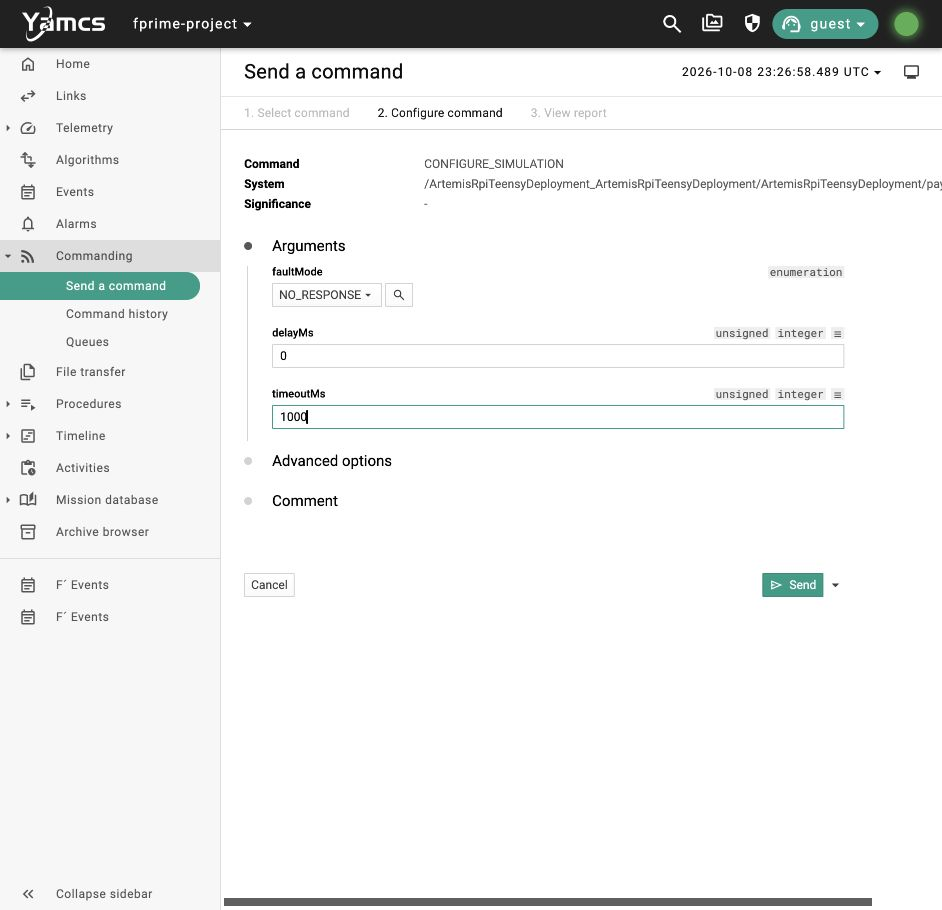
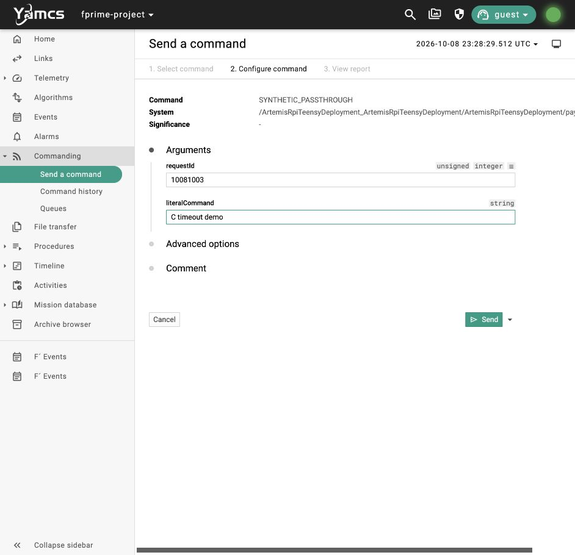
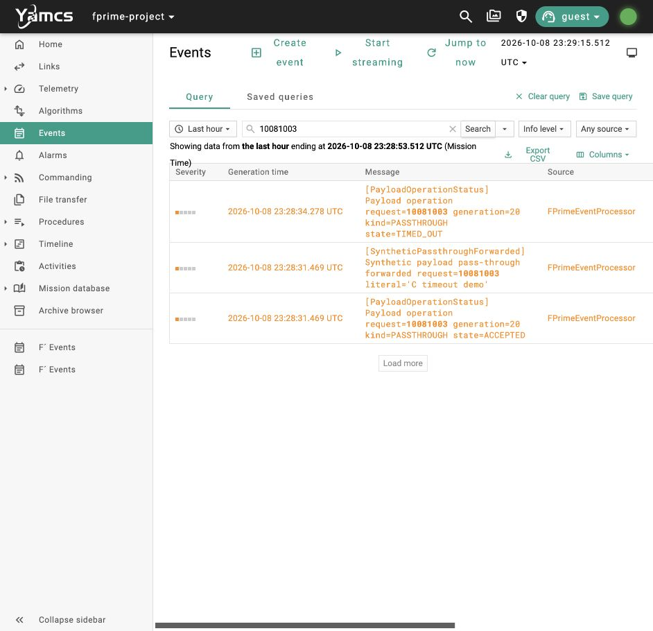
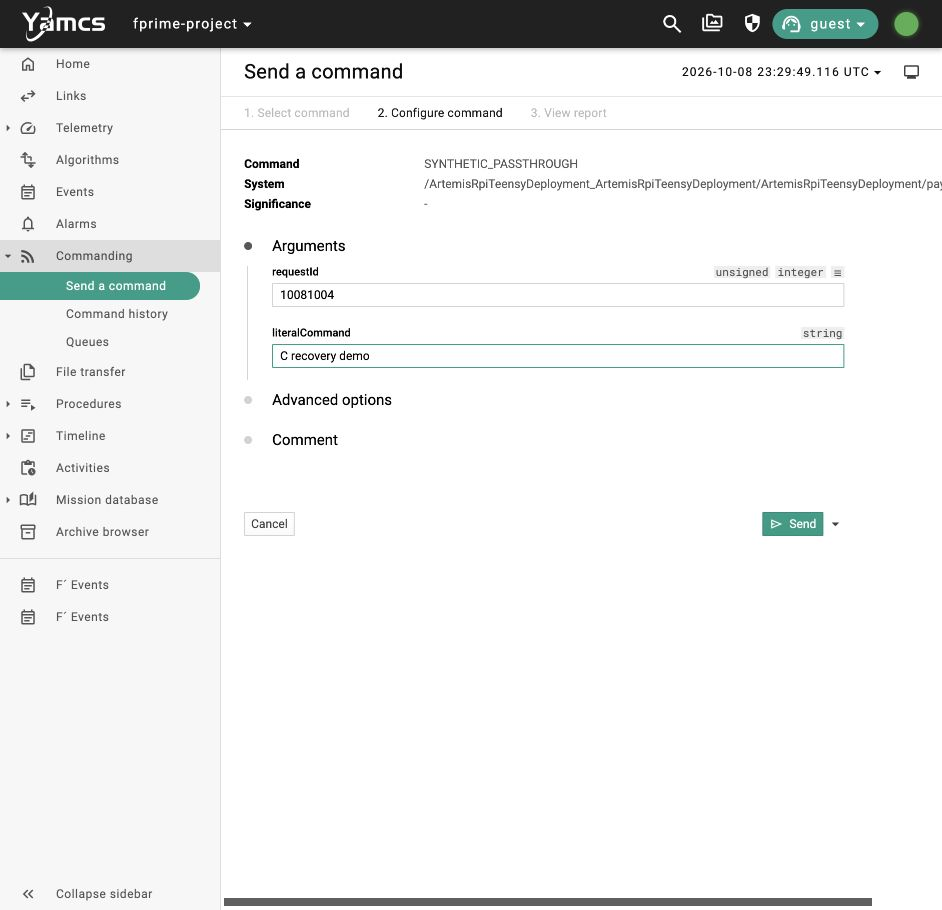
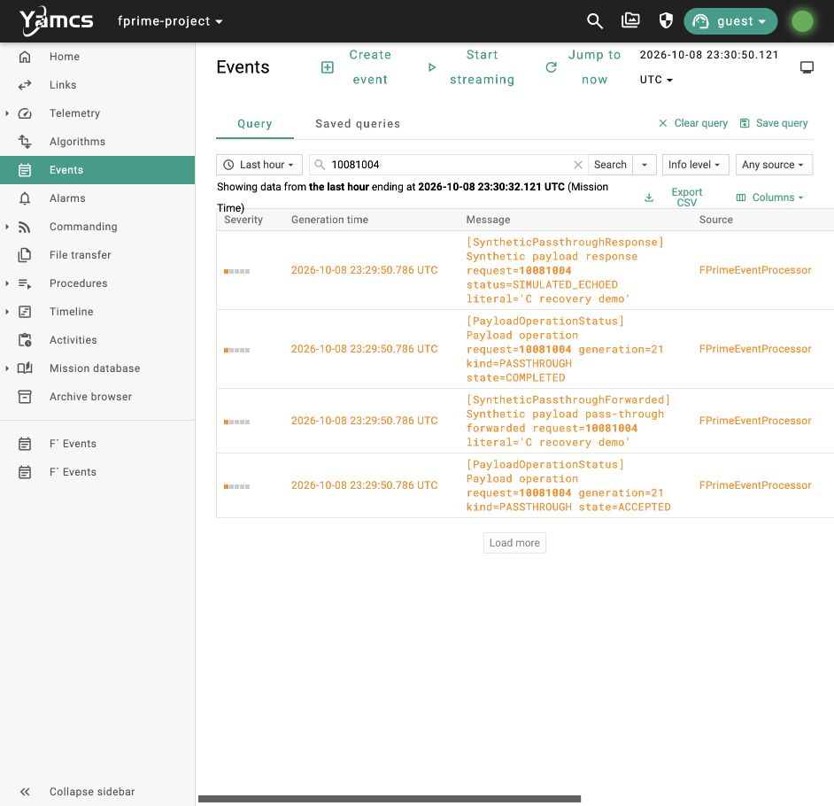

# N2 slice C: timeout and recovery operator walkthrough

**Confirmed October 8, 2026:** the local F′–Yamcs lifecycle demo passed all 31 acceptance checks before these screenshots were taken. This walkthrough then replayed a timeout and a successful recovery in the Yamcs UI, independently verified through returned Yamcs events and telemetry. It uses the native host executable and simulated payload; Pi Zero W, PLD hardware, SatNOGS/SPI, and RF acceptance remain pending.

## Prepare the local demo

From the `neutron_2` repository root, follow the [local setup runbook](../../development/YAMCS_LOCAL_TESTING.md). Start only one stack:

```sh
./tools/yamcs/build_native.sh
./tools/yamcs/run.sh
```

Leave the runner in the foreground. Open <http://127.0.0.1:8090>, choose instance `fprime-project` and processor `realtime`, and confirm the links are enabled. The [slice A walkthrough](PASSTHROUGH.md) shows the normal pass-through flow. Use unique, nonzero request IDs and keep other operator/probe commands idle during this replay. The IDs below identify the photographed run; choose new IDs when repeating it.

Yamcs's `Queued`, `Released`, and `Sent` acknowledgments describe command transport. F′ opcode completion describes command handling. **Use the returned `payloadManager.PayloadOperationStatus` events to judge the payload operation.** An admitted request receives `ACCEPTED` and exactly one `COMPLETED`, `FAILED`, or `TIMED_OUT` outcome with the same request ID and internal generation. An immediate rejection has generation `0` and state `BUSY`, `INVALID`, or `DRIVER_UNAVAILABLE`.

## 1. Configure one silent simulated response

Open **Commanding → Send a command**, search for `CONFIGURE_SIMULATION`, and choose the command under `ArtemisRpiTeensyDeployment/payloadManager`.

| Argument | Value |
| --- | --- |
| `faultMode` | `NO_RESPONSE` |
| `delayMs` | `0` |
| `timeoutMs` | `1000` |



Click **Send**. In **Events**, search for `SimulationConfigured` and confirm a fresh event with those three values. This command is enabled only in the local testing profile. The fault applies once to the next admitted operation and then resets to `NORMAL`; no second configuration is needed for the recovery step. Valid configuration ranges are delay `0–8000` ms and timeout `1000–8000` ms. Configuration while an operation is active is rejected.

## 2. Submit the request that will time out

Choose `payloadManager.SYNTHETIC_PASSTHROUGH` and enter:

| Argument | Photographed value |
| --- | --- |
| `requestId` | `10081003` |
| `literalCommand` | `C timeout demo` |



Click **Send**. Do not infer operation success from the green command acknowledgments.

## 3. Confirm the timeout through returned events

Open **Events**, enter `10081003`, and click **Search**. If the displayed time range ends before the command, click **Jump to now**. Wait for the query to finish loading.



Read events chronologically, from the bottom upward in this view: `ACCEPTED`, forwarded literal, then `TIMED_OUT`. The photographed request used generation `20`. There is no `SyntheticPassthroughResponse` for this request. The timeout is a monotonic deadline, checked by the manager's two-second scheduler and on replies; the configured milliseconds are not a promise of an exact ground display time.

## 4. Submit a normal request without restarting

Return to `payloadManager.SYNTHETIC_PASSTHROUGH`. The one-shot `NO_RESPONSE` fault has been consumed. Enter a new request ID and literal:

| Argument | Photographed value |
| --- | --- |
| `requestId` | `10081004` |
| `literalCommand` | `C recovery demo` |



Click **Send**. Keep the same F′ and Yamcs processes running.

## 5. Confirm recovery and the exact returned text

Open **Events**, search for the new request ID, and wait for the filtered rows:



**Pass:** fresh `ACCEPTED` and `COMPLETED` events share request `10081004` and generation `21`; `SyntheticPassthroughResponse` carries `status=SIMULATED_ECHOED` and `literalEcho=C recovery demo`. These are returned simulator observations. The UI replay kept `CurrentMode=BASE` with no mode-change events. Orange `WATCH` rows are the current mapping of F′ activity-high events, including successful outcomes.

## Repeat the complete acceptance matrix

The automated matrix needs a freshly started, otherwise idle application with zero collection/storage counters. Stop the current runner and start a new stack before repeating it; the Yamcs archive is retained and the probe filters for fresh evidence.

```sh
./tools/yamcs/stop.sh
./tools/yamcs/run.sh
```

In a second terminal:

```sh
./tools/yamcs/passthrough.sh
./tools/yamcs/lifecycle.sh
```

The lifecycle probe issues commands only through Yamcs and records returned events/telemetry under the active `yamcs/run/<timestamp>/`. Its 31 checks cover shared admission across literal, direct, legacy, ScienceApp, and scheduled capture entries; busy/invalid/unavailable rejection; failure and timeout recovery; stale replies after request-ID reuse; duplicates; hung child cleanup; and successful capture after the hang. Rejected, failed, or timed-out captures create no science-ready/storage success. Duplicate capture replies increment completion/storage counters only once. Existing mode/scheduling paths are exercised as regression coverage; December FSR modes and EPS integration have not been added or accepted here.

## Acceptance record

| Evidence | Result |
| --- | --- |
| Local native build | macOS arm64, `NEUTRON2_LOCAL_YAMCS=ON` — PASS |
| A regression | `yamcs/run/20261008-132335/passthrough-ee7f959c9f13.json` — PASS |
| C matrix | `yamcs/run/20261008-132335/lifecycle-4467b883d409.json` — PASS, 31 checks |
| ScienceApp unit tests | `scienceapp-ut.log` in the same run — PASS, 8 tests |
| Independent source/evidence review | Bounded C acceptance — PASS |
| UI timeout/recovery | `operator-lifecycle-ui-verification.json` in the same run — PASS |
| Screenshot order | All five captured after the full C matrix passed |

The run manifest records source HEAD `33aef0a186205e27d0a05be5a570614ef223de8c` plus local dirty changes. Running artifact hashes were independently recomputed and matched:

| Artifact | SHA-256 |
| --- | --- |
| Executable | `3d2192e159fc905398860ed9ca5a5aadf63084a5a9049a4b64bdfe87a5d7f41f` |
| Dictionary | `362ecc8d8568094b10c384658802e295c02ff9d5337d212e602331a5fe8f7581` |

Startup `42>35` string-decoding and `PrmIdNotFound 0x10007000` warnings remain unresolved. Acceptance covers the observed lifecycle fields, counters, modes, and recovery scenarios; arbitrary malformed/large child output was not stress-tested. The default OFF/hardware profile was not rebuilt or exercised. Changes remain local and uncommitted.

**Next: B**, the integrated nominal raw-data cycle with independently received bytes, identity/size/hash verification, and a ground-derived histogram when its format/tool is settled. The October CDR PLD/SatNOGS/SDR sequence and December FSR remain separate hardware/integration gates in the [development plan](../../planning/SDD_GAP_PLAN.md).
