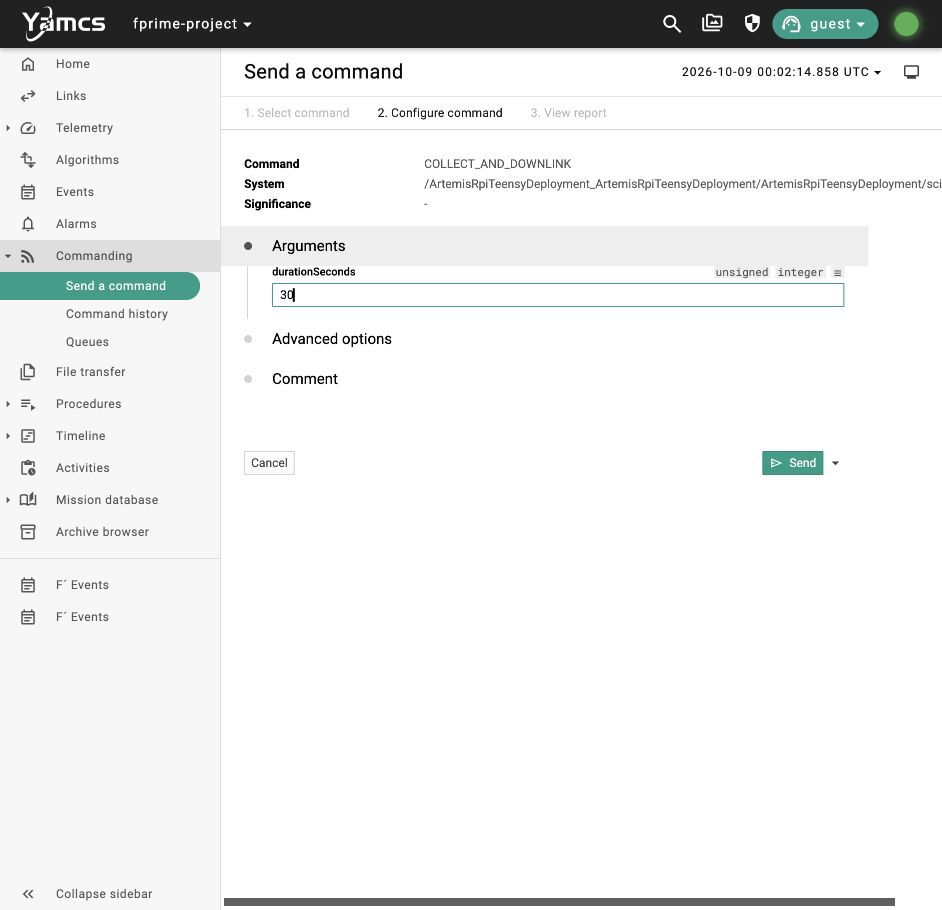
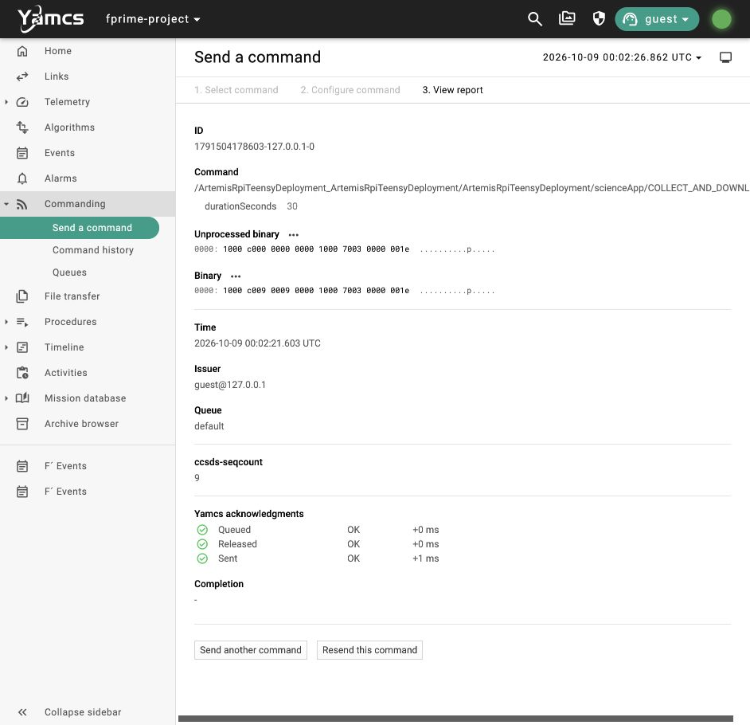
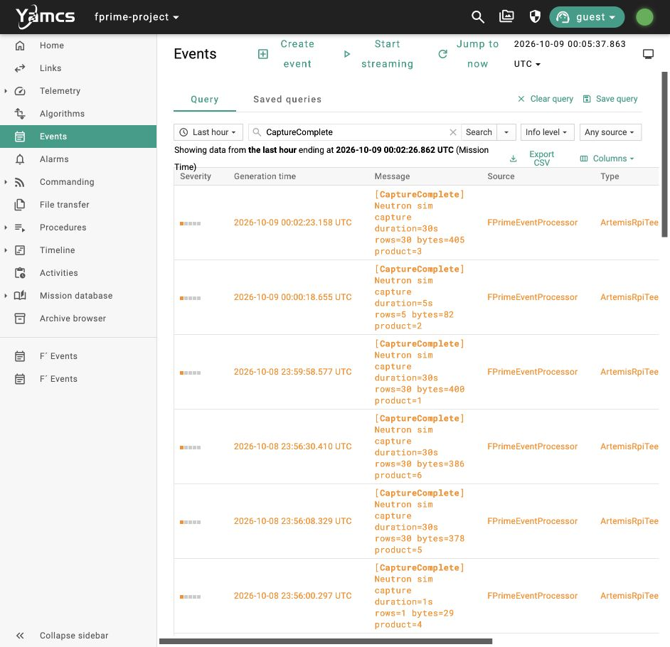
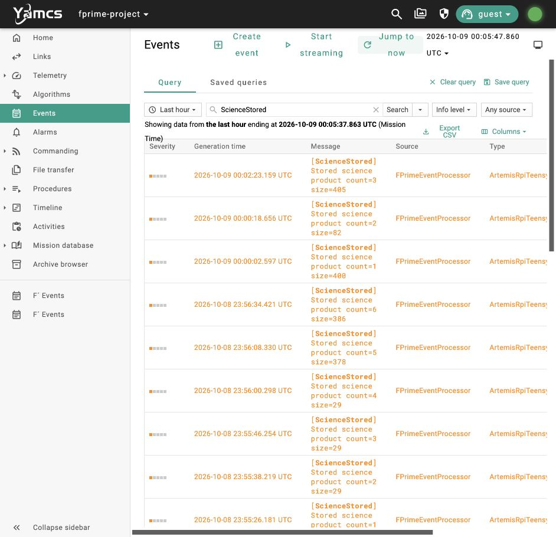
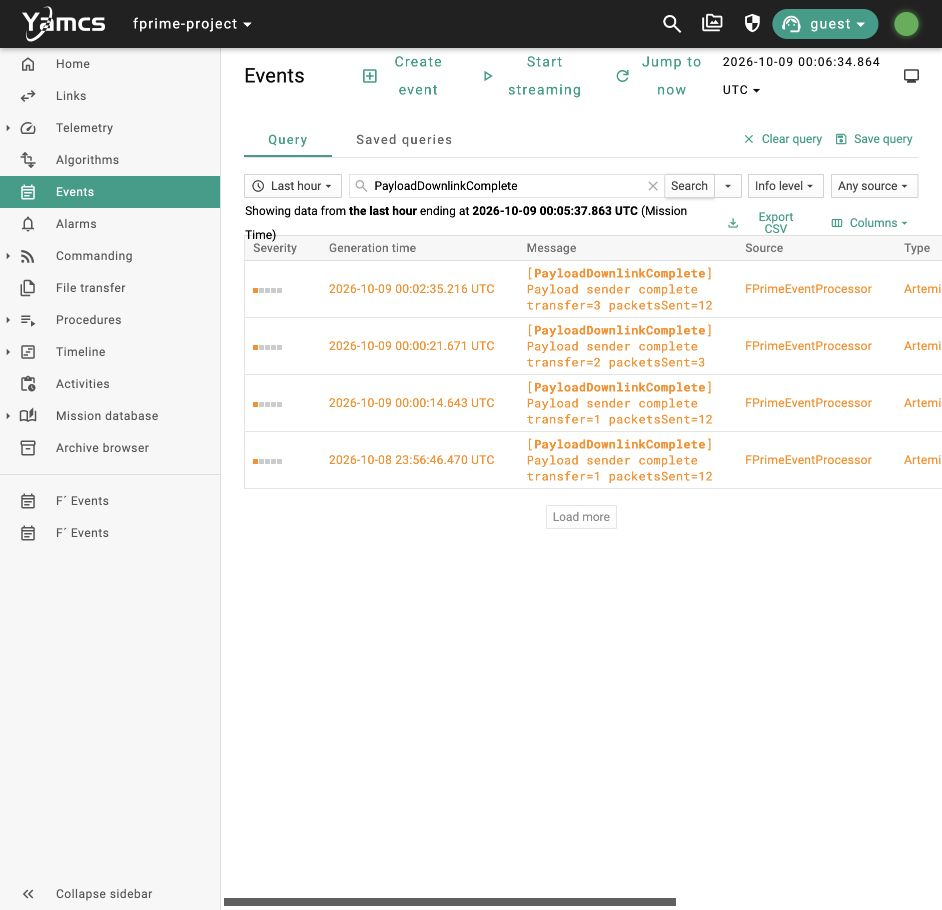
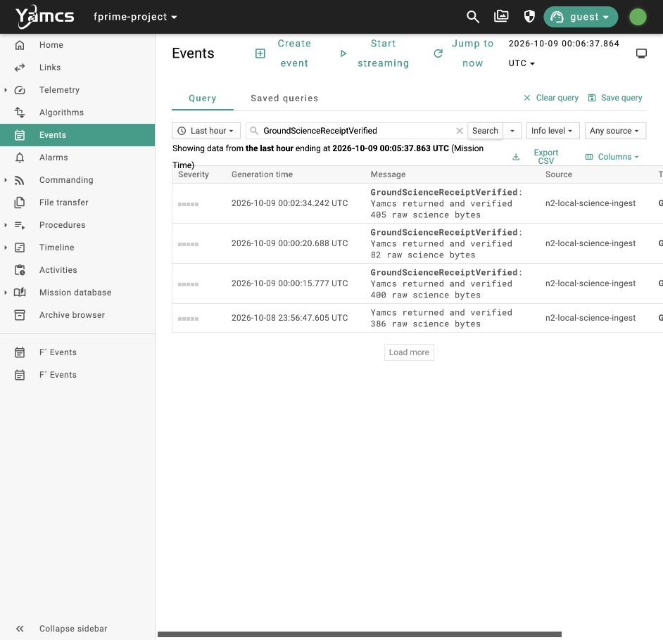
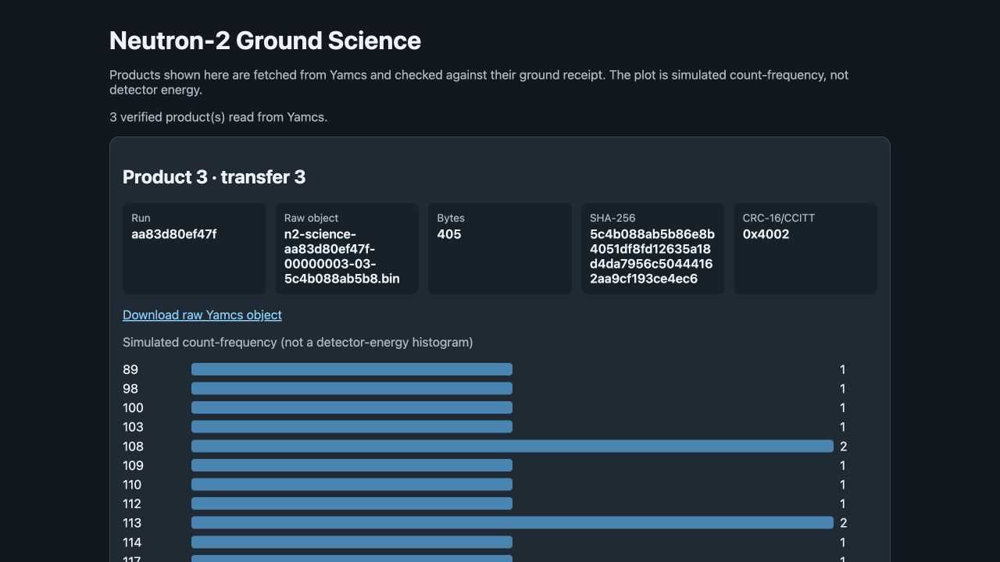

# N2 slice B: raw science cycle operator walkthrough

**Confirmed October 8, 2026:** Yamcs commanded collection, F′ finalized and stored a simulated raw product, the custom channel-1 receiver reconstructed its bytes, and Yamcs returned the verified raw file and receipt. The ground viewer computed a histogram from those returned bytes. The automated demo passed at **14:00:22 HST**, before any screenshots in this guide. A subsequent UI replay also passed.

This is the local software demo. The real PLD interface, Pi Zero W runtime, SatNOGS SPI firmware, SDR/RF route, and October hardware demonstration still need integration and acceptance. This command is a numeric ScienceApp facade; Aris's opaque payload command and real raw format remain open. No operator mode transition, scheduling, or EPS action is needed for this replay. Existing internal mission status changes still occur.

## Prepare the local demo

From the `neutron_2` repository root, follow the [local setup runbook](../../development/YAMCS_LOCAL_TESTING.md), then start one stack:

```sh
./tools/yamcs/build_native.sh
./tools/yamcs/run.sh
```

Leave the runner in the foreground. Open <http://127.0.0.1:8090>, select instance `fprime-project` and processor `realtime`, and confirm the links are enabled. The companion ground viewer is <http://127.0.0.1:8063>. Keep other commands and automated probes idle during the walkthrough. Begin in BASE with no active collection/downlink. Collect one product at a time and wait for its verified ground receipt and sender completion before starting another.

The photographed run's nonce is `aa83d80ef47f`. Product IDs and transfer IDs can repeat across application restarts; match the current run nonce, product, transfer, timestamp, size, and hash. Yamcs retains archive events from earlier runs. The UI uses UTC: October 9 `00:02` UTC is October 8 `14:02` HST.

## 1. Command collection and automatic delivery

Open **Commanding → Send a command**, search for `COLLECT_AND_DOWNLINK`, and select the command under `ArtemisRpiTeensyDeployment/scienceApp`.

| Argument | Photographed value | Valid range |
| --- | --- | --- |
| `durationSeconds` | `30` | `1–120` seconds |



Click **Send** once. The duration applies only to this request; it does not change the configured default capture duration. The simulator produces one row per requested window without waiting the full wall-clock acquisition duration. Real payload timing remains part of hardware integration.

## 2. Check transport acknowledgment



`Queued`, `Released`, and `Sent` show command transport. They do not prove capture or ground delivery. The photographed command ID is `1791504178603-127.0.0.1-0`, released at `2026-10-09 00:02:21.603 UTC`. Use the returned events below to judge the operation.

## 3. Confirm capture and storage

Open **Events**, enter `CaptureComplete`, and click **Search**. Click **Jump to now** if the query time range ends before your command. Wait for the filtered rows to finish loading. Match the fresh event to your command time and requested duration.



The UI replay returned product `3`, duration `30s`, `30` rows, and `405` bytes at `00:02:23.158 UTC`. For admission or failure details, query `PayloadOperationStatus`; the replay's capture request was `4`, generation `6`. An accepted request has one correlated terminal outcome. A rejected or failed capture must not produce a stored product or automatic downlink.

Search for `ScienceStored`:



The fresh stored event reports count `3`, size `405`, at `00:02:23.159 UTC`. Storage validates the finalized descriptor before handing it to downlink. Orange rows are the current Yamcs mapping of F′ activity-high events, including successful capture/storage.

## 4. Confirm the sender's status

Search for `PayloadDownlinkStarted` to bind product `3` to transfer `3`: `405` bytes and `12` packets. Then search for `PayloadDownlinkComplete`:



The fresh event says **sender complete**, transfer `3`, `12` packets sent. This confirms local sending. Ground receipt is a separate observation. The sender snapshots the validated product's bytes so later file changes cannot change a retry's contents.

## 5. Confirm independent ground receipt

Search for `GroundScienceReceiptVerified`:



The replay returned `405` verified bytes. The receiver checks packet CRC, complete packet coverage, whole-product CRC, and matching END. It uploads only reconstructed channel-1 bytes to Yamcs bucket `fprimeFilesIn`, downloads the raw object again, checks size/SHA-256, and uploads/downloads the matching receipt before emitting this event. It never copies a flight-side source file into ground storage.

A verified ground event can arrive shortly before local sender completion because the receiver has already seen END while the sender finishes its state updates. Require both observations; their display order alone is not a failure.

## 6. View and download the raw product

Open <http://127.0.0.1:8063> and refresh after the new receipt arrives. Match the current nonce and product/transfer identity on the latest card.



The replay's raw object is `n2-science-aa83d80ef47f-00000003-03-5c4b088ab5b8.bin`, size `405`, CRC-16/CCITT `0x4002`, SHA-256:

```text
5c4b088ab5b86e8b4051df8fd12635a18d4da7956c50444162aa9cf193ce4ec6
```

Click **Download raw Yamcs object**. The photographed download was independently checked against the receipt and returned Yamcs bytes. The file has a `.bin` suffix, but this simulator's content is UTF-8 CSV with header `t_s,counts,flag`. The histogram groups acquisition windows by their `counts` value; its bar lengths represent window frequency. It is a simulated count-frequency plot, not a detector-energy histogram. The replay shows **30 windows and 3,573 total counts**.

The [full-page ground screenshot](images/n2-raw-cycle-2026-10-08/08-ground-products-full.jpg) includes all bins and the two preceding accepted products. No histogram is generated on the simulated payload; the ground viewer fetches the raw Yamcs object and derives the plot itself. Aris's real raw format will determine the production parser and scientific plot.

**Operator pass:** fresh capture and storage events, matching sender product/transfer, a verified ground receipt, and a raw download whose size/hash match the receipt. Start another collection only after these checks. If receipt is missing, retain the raw source and inspect receiver/link errors; local sender completion alone does not authorize deletion or prove delivery.

## Repeat the automated acceptance demo

Stop the existing runner and start a fresh, idle stack. To reproduce the accepted recovery experiment, enable its explicit software fault profile:

```sh
./tools/yamcs/stop.sh
N2_LOCAL_SCIENCE_FAULTS=drop-first-0,corrupt-first-1 ./tools/yamcs/run.sh
```

In a second terminal:

```sh
./tools/yamcs/passthrough.sh
./tools/yamcs/raw_cycle.sh
```

`raw_cycle.sh` requests 30- and 5-second products through Yamcs. The first transfer deliberately loses one packet and corrupts another, then recovers both through channel-1 retry requests. The second transfer is nominal. It also checks invalid-duration and failed-capture suppression, same-request-ID BUSY rejection without losing the accepted automatic-delivery intent, distinct raw objects, retained sources, independent Yamcs readback, and the histogram calculation. For a normal operator replay, use `run.sh` without the fault variable.

## Acceptance evidence and limits

| Evidence | Result |
| --- | --- |
| Native F′ build | macOS arm64, `NEUTRON2_LOCAL_YAMCS=ON` — PASS |
| B automated demo | `yamcs/run/20261008-135910/raw-cycle-ae95a2520a64.json` — PASS at 14:00:22 HST |
| Product 1 / transfer 1 | 400 bytes; 30 windows; 3,145 counts; one dropped and one corrupted packet recovered |
| Product 2 / transfer 2 | 82 bytes; 5 windows; 562 counts; nominal transfer |
| UI replay / downloaded product 3 | `operator-raw-cycle-ui-verification.json` in the same run — PASS; 405 bytes, 30 windows, 3,573 counts |
| A regression | `passthrough-0a7935f0b7fa.json` in the same run — PASS, exact 59/128-byte literals |
| C regression | `yamcs/run/20261008-135404/lifecycle-b4ae7d0400bf.json` — PASS, 31 checks on the same binary/dictionary |
| Component unit tests | 6 suites / 31 cases — PASS; current run's `component-ut-check.log` and `component-ut-details.log` |
| Ground unit tests | 7 cases — PASS; current run's `ground-ut.log` |
| Independent review | Raw identity, downloaded bytes, CRC/SHA, histogram, recovery, and evidence consistency — PASS |

The running binary SHA-256 is `ae7bf3de83b79dab247a004a365eff180b115b4aa37d00026bb6696f4451119c`; dictionary SHA-256 is `a841a26b99689e5b10ec48d22e61208e2cf369ec39bbc59e314b9f9d53a231b6`. The acceptance record fingerprints the five ground Python sources and confirms they did not change during the probe. The UI verification record repeats that check. [Screenshot timestamps and hashes](images/n2-raw-cycle-2026-10-08/capture-times.json) prove all eight images were captured after automated acceptance.

The earlier `yamcs/run/20261008-135404/raw-cycle-11442c11cf49.json` failed because the ground receipt's event message omitted the search token used by the probe. The raw object had been verified, but that run was not accepted. The event message was corrected, the stack restarted, and the final run above passed. Earlier failed evidence remains available.

Storage currently uses an in-memory catalog and retained `/tmp` files. Sender snapshotting and retention passed; reboot durability, catalog restoration, quota/reclamation, and a positive ground-receipt acknowledgment on the flight wire remain future work. The receipt is ground evidence, not an ACK back to F′. Stock FileDownlink was not used by B. This acceptance establishes the bounded software cycle and leaves the real PLD/SPI/RF route and December modes/EPS/time sequencing for their own demos.
