# CDR TCP/Yamcs implementation and handoff plan

**BLUF:** For October CDR, command the real Pi Zero W F′ deployment from Yamcs over the local network using native `Drv.TcpServer`. Keep the Pi↔Teensy UART for PDU control and USB↔RS-422 for the payload. CDR demonstrates payload power on → collection → raw-product retention/inspection → payload power off. SatNOGS, SDR and RF are deferred to the complete FSR chain.

**Date:** October 18, 2026; selection/hardware update October 19, 2026.
**Status:** Dennis selected Pi Zero W F′ TCP ↔ LAN ↔ Pi 5/Yamcs for CDR on October 19. Prior source/configuration feasibility evidence is recorded below; implementation and target/hardware testing remain pending. No adapter implementation is authorized by this documentation checkpoint.
**Checkout:** `neutron2-develop`, source HEAD `5429a2fc22f90bea77889f3695597b68b4c64fcf` before this documentation work. Existing documentation edits and untracked files must be preserved. This plan adds no working TCP transport to the current binary.

## Outcome and placement

```mermaid
flowchart LR
    Browser["Operator browser"] <-->|"HTTP / Yamcs web interface"| Ground["Ground host: Yamcs + fprime-yamcs bridge"]
    Ground <-->|"LAN TCP / CCSDS TM and TC"| TCP["Pi Zero W: native Drv.TcpServer"]
    TCP <--> CCSDS["F′ ComCcsds / command dispatcher / events / telemetry"]
    CCSDS --> Apps["Existing applications and managers"]
    Apps <-->|"USB ↔ RS-422"| Payload["Real payload"]
    Apps <--> EPS["EpsManager / EpsDriver_Artemis"]
    EPS <-->|"UART mux channel 2"| Teensy["Satellite Teensy / PDU proxy"]
    Teensy <--> PDU["PDU"]
    PDU -->|"Payload power on/off"| Payload
```



The diagram shows responsibilities, not a connector/pinout or completed wiring. The satellite Pi Zero W runs the spacecraft binary. The ground host runs Yamcs/F′ ground services, not a second spacecraft mission controller. Use the already-verified macOS host for initial development; the intended dedicated ground host is Pi 5 Ubuntu, whose deployment/resource validation remains separate.

TCP belongs at the ground-link driver interface to `ComCcsds`. Do not replace `CommsDriver_TeensyRfm23` with a TCP component in place: the former is an RF status/control shim with different port semantics. `CommsApp` remains a mission-level delivery coordinator. A native TCP driver is sufficient for the proposed command/telemetry transport; a custom TCP radio manager is not needed for that role.

## What was verified

- F′ is pinned to v4.2.1, commit `a750219414881d3461054e73c25a0868a5e648f9`.
- That framework contains `Drv.TcpServer`, its byte-stream send/receive and buffer-return ports, buffer allocation/deallocation, connection-ready notification and socket lifecycle/reconnect support. Linux/POSIX sockets are supported by its build registration.
- The installed ground environment contains `fprime-yamcs==0.2.4` and `fprime-gds==4.4.0`.
- `fprime-yamcs --help` and argument parsing accept `tcp-fast-client`, `--tcp-fast-address`, `--tcp-fast-port` and `--no-app`.
- The launcher starts `fprime-comm-bridge` with the chosen TCP client and `tm-frame-aggregator` framing. Its UDP connection to Yamcs stays on ground-host loopback; the Pi Zero does not need a UDP deployment for this design.
- An isolated loopback TCP adapter test passed bidirectional send/receive. A separate framing test reassembled a 128-byte CCSDS TM frame from fragmented TCP chunks and passed complete TC frames unchanged.
- These tests did not run the modified N2 topology, a real native F′ TCP server deployment, the current binary on the Pi, or any payload/PDU hardware. They are adapter/framing evidence, not integrated CDR acceptance.

Source references:

- [Pinned TcpServer implementation](../../ArtemisRpiTeensy_N2/lib/fprime/Drv/TcpServer/TcpServerComponentImpl.cpp), [interface/lifecycle](../../ArtemisRpiTeensy_N2/lib/fprime/Drv/TcpServer/TcpServerComponentImpl.hpp), [socket binding](../../ArtemisRpiTeensy_N2/lib/fprime/Drv/Ip/TcpServerSocket.cpp).
- [Current topology](../../ArtemisRpiTeensy_N2/ArtemisRpiTeensyDeployment/Top/topology.fpp), [instances](../../ArtemisRpiTeensy_N2/ArtemisRpiTeensyDeployment/Top/instances.fpp), [startup/shutdown](../../ArtemisRpiTeensy_N2/ArtemisRpiTeensyDeployment/Top/ArtemisRpiTeensyDeploymentTopology.cpp), [current UART-only CLI](../../ArtemisRpiTeensy_N2/ArtemisRpiTeensyDeployment/Main.cpp).
- [Current host-only launcher](../../tools/yamcs/local_stack.py), [software UART/science adapter](../../tools/yamcs/local_link.py).
- [Upstream fprime-yamcs adapter documentation](https://github.com/fprime-community/fprime-yamcs#usage), [F′ GDS communication bridge](https://github.com/nasa/fprime-gds). Installed package source and pinned framework take precedence over moving upstream documentation.

## Implementation sequence

### 1. Add an explicit CDR TCP profile

Keep the existing local simulation and legacy UART/RF profiles available. Introduce a clearly named CDR TCP transport selection independent of `NEUTRON2_LOCAL_YAMCS`, which is currently a host-testing option and enables local-only fixture behavior.

Choose and document CDR frame/string/buffer sizing explicitly. The older OFF/RF profile uses 128-byte TM frames; the current local profile uses 1024-byte TM frames. Generate the executable and dictionary together from the selected CDR configuration. Do not treat an existing host dictionary or macOS executable as the Pi hardware release.

Likely owning files: project `CMakeLists.txt`, deployment `CMakeLists.txt`, and a profile-specific configuration/topology input if needed. Avoid hand-editing generated code and protocol constants.

### 2. Split network ground traffic from satellite-local UART

Add a separate native `groundTcp: Drv.TcpServer` instance and wire:

- `groundTcp.$recv → ComCcsds.comStub.drvReceiveIn`.
- `ComCcsds.comStub.drvReceiveReturnOut → groundTcp.recvReturnIn`.
- `ComCcsds.comStub.drvSendOut → groundTcp.$send`.
- `groundTcp.ready → ComCcsds.comStub.drvConnected`.
- TCP receive-buffer allocate/deallocate ports to the configured comms buffer manager, with a read size supported by its pools.

Retain the existing UART driver, UART mux and `EpsDriver_Artemis` channel-2 request/response bindings to the Teensy. Ground CCSDS traffic must bypass the custom UART channel envelope. Keep buffer ownership/return paths correct for both drivers.

Guard or explicitly handle unused mux channels in this profile. In particular, current `UartChannelMux::handleFrame` unconditionally invokes the channel-0 output; removing that connection without handling unexpected channel-0 input could assert. Do not let legacy RF status masquerade as TCP link health. Disable/reject unused radio-delivery paths in the CDR profile rather than silently forwarding science toward RF.

Likely owning files: `Top/instances.fpp`, `Top/topology.fpp`, and narrowly scoped `Components/UartChannelMux/` changes if required. Preserve existing profile behavior and relevant mux tests.

### 3. Configure TCP startup and lifecycle

Add CLI/configuration fields for the server's listening IPv4 address and port alongside the existing UART device. The present binary only accepts `-d` for UART; TCP address/port options are implementation work, not existing commands.

Configure the TCP server, check startup status, start its receive thread, and stop/join it during teardown. Verify bounded send/reconnect behavior, shutdown with no client, and shutdown after disconnect. Retain the UART lifecycle for PDU traffic.

Proposed bench endpoint: TCP port `50000`, bound to the Pi's LAN IPv4 address or `0.0.0.0` as appropriate. Ground connects to the actual Pi LAN IPv4 address; it must not use `0.0.0.0` as the remote destination. A reserved router address makes rehearsal repeatable. This is a proposed endpoint, not a discovered Pi address.

Likely owning files: `Main.cpp`, `Top/ArtemisRpiTeensyDeploymentTopologyDefs.hpp`, `Top/ArtemisRpiTeensyDeploymentTopology.cpp` and build dependencies.

### 4. Add a ground-only CDR Yamcs launcher

Create a launcher that prepares ground runtime configuration and connects to the already-running Pi. Do not reuse `run_pulses.sh` unchanged: it starts a host-native simulated spacecraft and software UART/science adapter.

Verified connection flag template, to be supplied by the new launcher:

```text
fprime-yamcs
  --no-app
  --dictionary <dictionary-from-matching-CDR-Pi-build>
  --communication-selection tcp-fast-client
  --tcp-fast-address <PI_ZERO_LAN_IPV4>
  --tcp-fast-port 50000
  --yamcs-config-dir <prepared-ground-config>
  --yamcs-data-dir <ground-runtime-data>
```

The wrapper must handle runtime paths/configuration and the matching dictionary, rather than treating the template above as a complete current runbook. Preserve CCSDS framing; the installed launcher selects `tm-frame-aggregator` for the bridge automatically. Do not add the UART mux envelope to the TCP stream.

Browser access and the spacecraft TCP endpoint are different settings: Yamcs HTTP is currently loopback-only at port `8090`. Configure the ground web server for the intended LAN browser clients when deploying to Pi 5. Only the ground bridge connects to the single-client F′ TCP server; multiple browsers use Yamcs.

Likely owning files: a new `tools/yamcs/run_cdr_tcp.sh` or equivalent wrapper, ground runtime configuration preparation, and the corresponding operations guide. Keep local simulator launchers intact. Validate macOS first; follow the repository's WSL policy for F′ development on Windows.

### 5. Keep the CDR science sequence independent of RF delivery

Use Yamcs for PDU and payload commanding and returned events/telemetry:

1. Request PDU status/readback, then command the confirmed payload output ON.
2. Confirm power/readiness using agreed hardware indicators and startup timing.
3. Use the collection-only path, such as existing `scienceApp.SCIENCE_CAPTURE`, once the real USB↔RS-422 driver is integrated.
4. Observe terminal collection and storage outcomes, retain the raw product and record identity/size/integrity. F′ command acknowledgment alone is not collection success.
5. Command payload output OFF and verify its off state after the product is safely retained.
6. Retrieve a copy over SSH/SCP for CDR inspection and compare its integrity to the retained product metadata.

Do not use `COLLECT_AND_DOWNLINK` or `VERIFIED_COLLECT_AND_DOWNLINK` as a substitute for this collection-only flow: their current automatic science delivery uses custom channel 1, which does not move to TCP merely because CCSDS traffic does. Existing VERIFIED ground-delivery semantics must not report success without actual independent delivery evidence. Stock F′ file transfer over the new network link can be evaluated later as a separate slice; it is not necessary for the initial CDR collection/PDU demonstration.

The TCP transport slice can be developed with synthetic payload and a fake PDU endpoint first. Integrating the real USB↔RS-422 payload adapter and physical PDU remains separate work below the same application/manager contracts.

## Acceptance gates

| Gate | Required evidence |
| --- | --- |
| Source/build | Explicit CDR profile; matching binary/dictionary; native build and relevant component tests; previous simulation/legacy profiles preserved |
| Host network | Yamcs PING produces a fresh matching Pong over native F′ TCP; events and telemetry decode with matching framing |
| Stream/recovery | Fragmented/coalesced traffic, client reconnect, absent client and shutdown work without crash, buffer leaks or indefinite blocking |
| PDU path isolation | Yamcs EPS commands reach fake channel-2 UART/PDU and responses return as telemetry; ground CCSDS bypasses UART; no RF forwarding is required |
| Capture/storage | Synthetic collection-only request creates one retained product; invalid/failed requests produce truthful outcomes; no automatic RF science delivery |
| Target runtime | Correct ARMv6 Pi Zero W build, matching dictionary, actual LAN connectivity and resource/runtime checks |
| Authorized CDR hardware | Real PDU output on/readiness → real payload collection → validated retained/retrieved product → output off/readback, with exact board/firmware/binary identity recorded |

Test hardware failure cases only under the agreed runbook. Do not infer that the bench passed from source inspection, host tests, a listening socket or a healthy Yamcs process.

## Confirmed hardware allocation — October 19

PDU is Artemis hardware v2.2, reported mostly wired: Pi Zero W F′ UART mux/local channel 2 → satellite Teensy → UART → PDU protocol v2. The selected firmware reference is [`codex/pdu-protocol-refactor`](https://github.com/hsfl/artemis-cubesat-pdu-firmware/tree/codex/pdu-protocol-refactor); this checkpoint does not update the pinned submodule or verify installed firmware.

FSR adds Pi Zero W SPI/custom SatNOGS driver → breakout/6-pin Molex-to-PC104 harness → separately powered PHASMA SatNOGS-COMMS v0.3.2 → UHF SMA/coax RF → USRP B200 → USB → Pi 5/Yamcs → LAN operator. Harness and firmware/ground software contracts remain TBD. Sam/Zach own SDR/demodulation and the matching RF setup; S-band is not assumed.

## Hardware inputs and handoff boundaries

- Actual Pi address, host OS/runtime and desired TCP port; ground host readiness.
- Payload USB↔RS-422 adapter/settings, public collection command/lifecycle and raw-file transfer contract from Aris.
- Populated PDU/firmware, confirmed payload output ID/rail and harness/readback, readiness/shutdown timing and recovery behavior. See [PDU integration](../integration/PDU.md).
- Existing Teensy firmware still initializes/polls RFM23BP. Define and verify a radio-disabled CDR setup that preserves PDU proxy, watchdog and Pi power behavior; do not assume routing ground traffic away alone proves that RF is disabled.
- No SatNOGS/SPI/SDR contract is needed to start the CDR TCP software slice. Sam/Zach's full COMMS integration remains an FSR dependency.

The receiving agent should first read [AGENTS.md](../../AGENTS.md), [system architecture](../architecture/SYSTEM_ARCHITECTURE.md), [development intent](DEVELOPMENT_INTENT.md) and applicable project skills; verify its own branch, working tree and submodules. Preserve this checkout's existing documentation work and pre-existing untracked review/images. Do not reset/clean/switch branches to match an old note.

This handoff is a plan. It does not authorize flashing, Pi deployment, RF operation or real payload/PDU power switching. No implementation, staging, commit or push is part of saving this document. Untracked files require an explicit copy or later Git commit before another machine can receive them through Git; the parent workspace does not automatically transfer independent child-repository working files.
